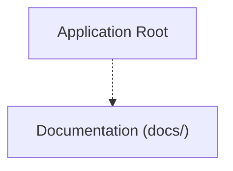

# Project Map & Architecture: LiquidDynamo-1.9.2
Generated on: 2026-11-03T05:43:29.509Z | Total Tracked Files: 459

## Architecture Flowchart


## Directory Structure Map
```text
.
├── .agents/ (3 files)
│   ├── plugins/ (1 file)
│   └── rules/ (2 files)
├── .github/ (1 file)
│   └── workflows/ (1 file)
├── Configuration/ (4 files)
│   └── dmg/ (4 files)
├── Frameworks/ (2 files)
├── LiquidDynamo.xcodeproj/ (5 files)
│   └── project.xcworkspace/ (4 files)
├── LiquidDynamoXPCHelper/ (5 files)
├── docs/ (16 files)
│   └── assets/ (2 files)
├── liquiddinamo/ (394 files)
│   ├── Assets.xcassets/ (46 files)
│   ├── Features/ (146 files)
│   ├── MediaControllers/ (8 files)
│   ├── Preview Content/ (1 file)
│   ├── Providers/ (1 file)
│   ├── Resources/ (48 files)
│   ├── Shortcuts/ (1 file)
│   ├── XPCHelperClient/ (2 files)
│   ├── animations/ (2 files)
│   ├── components/ (82 files)
│   ├── enums/ (1 file)
│   ├── extensions/ (13 files)
│   ├── helpers/ (7 files)
│   ├── managers/ (11 files)
│   ├── menu/ (1 file)
│   ├── metal/ (2 files)
│   ├── models/ (8 files)
│   ├── observers/ (3 files)
│   ├── private/ (1 file)
│   ├── sizing/ (2 files)
│   └── utils/ (1 file)
├── mediaremote-adapter/ (8 files)
│   └── MediaRemoteAdapter.framework/ (6 files)
├── scripts/ (9 files)
├── updater/ (1 file)
├── .gitignore
├── CHANGELOG.md
├── LICENSE
├── NOTICE.md
├── README.md
├── RULES.md
├── SECURITY.md
├── THIRD_PARTY_LICENSES
├── build_dmg.sh
├── crowdin.yml
└── install.sh
```
