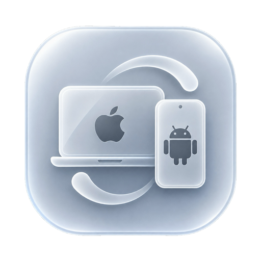
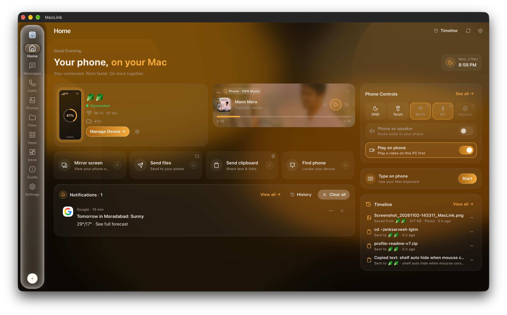
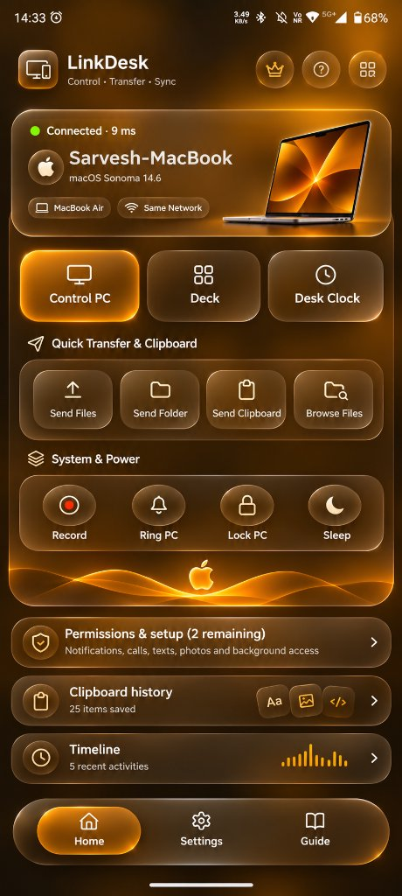
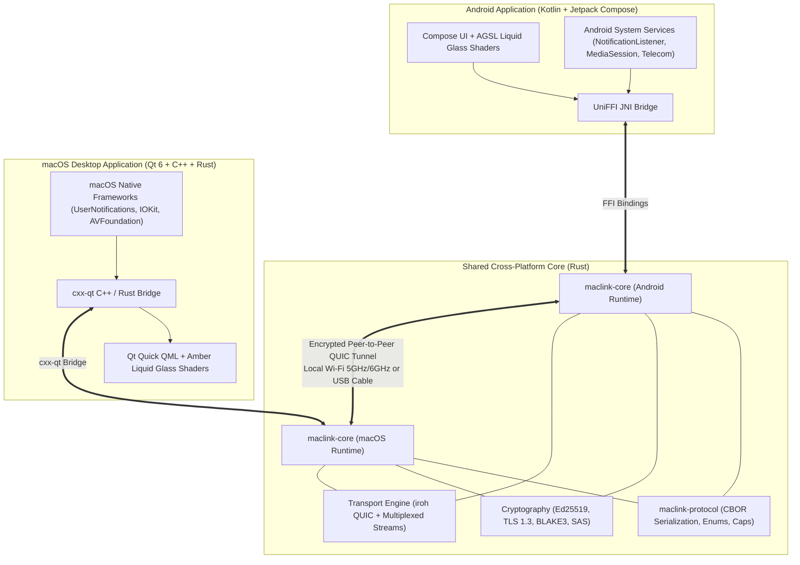
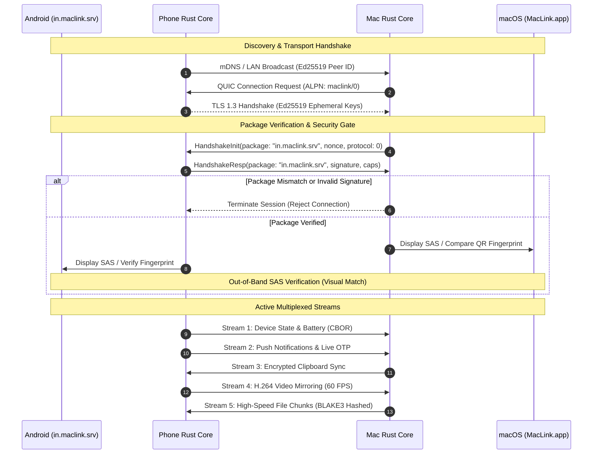
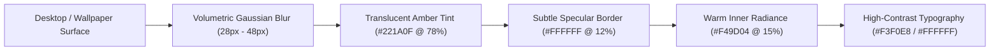

<div align="center">



# MacLink

**Your Android phone and your Mac, working seamlessly as one.**

Notifications, messages, phone calls, bidirectional clipboard, gigabit file transfers, photo library access, and low-latency hardware-accelerated screen mirroring between Android and macOS.

*Local-first • Zero-Cloud • End-to-End Encrypted via QUIC & TLS 1.3 • Apple Liquid Glass Edition*

---

[](https://github.com/anksarvesh-lgtm/MacLink/releases)
[-black.svg?style=flat-square&logo=apple)](desktop/packaging/macos/build-app.sh)
[-3DDC84.svg?style=flat-square&logo=android&logoColor=white)](android/)
[](core/maclink-core/src/session.rs)
[](rust-toolchain.toml)
[](desktop/app/)
[](LICENSES/GPL-3.0-or-later.txt)

</div>

---

## 📸 Visual Showcase

<div align="center">

### Desktop Interface (macOS · Amber Liquid Glass)


<br/><br/>

### Mobile Interface (Android · Liquid Glass Edition)


</div>

---

## ✨ Key Capabilities

- **Apple Liquid Glass Aesthetic**: Crafted with physical optical properties—Snell refraction, chromatic dispersion along borders, dual-axis warm specular highlights, and natural spring motion in deep amber/warm charcoal surfaces.
- **Strict Package Verification Gate**: Handshakes enforce cryptographically verified package identities (`in.maclink.srv`). Mismatched or spoofed clients are rejected before session creation.
- **Live Notification Mirroring**: Push notifications from Android directly to macOS with interactive inline quick-replies, dismiss-sync, and one-tap OTP verification code clipboard copying.
- **Unified SMS & Messaging**: Read and compose SMS, RCS, and chat threads directly in a fluid desktop interface with photo attachment support.
- **Phone Calls & Dialer**: Receive caller ID alerts, accept or reject incoming phone calls from your Mac, dial contacts directly, and route phone audio.
- **End-to-End Encrypted Clipboard Sync**: Bidirectional real-time clipboard sharing for text and images with automatic sensitive credential filtering (passwords, auth tokens).
- **Gigabit Drag-and-Drop File Transfers**: Transfer folders and multi-gigabyte files over local Wi-Fi or USB with BLAKE3 integrity verification and automatic transfer resume.
- **Phone Screen Mirroring & PC Control**: Hardware-accelerated 60 FPS H.264 display streaming with sub-frame input latency, keyboard navigation, and touch simulation.
- **Audio Routing & Media Handoff**: Control music playback across Spotify, YouTube Music, and local media; toggle playback, adjust volume, or route audio output.
- **Zero-Dependency FTP File Server & macOS Finder Mount**: Powered by embedded MinimalFTP on Android and one-ftpserver compatibility. Mount your Android phone storage directly in macOS Finder (`Go › Connect to Server › ftp://...`) as a native volume, or browse and transfer files with FileZilla, Cyberduck, or terminal clients over Wi-Fi.
- **Device Management & Power Controls**: Ring phone to find it, trigger DND, flashlight, battery health monitoring, lock PC, and trigger sleep mode remotely.

---

## 🏛️ System Architecture

MacLink utilizes a memory-safe, shared Rust core powering both native frontends via zero-overhead foreign function interfaces (FFI).



---

## 🔐 Cryptographic Handshake & Protocol Flow

Every connection guarantees zero external server interaction, mutual authentication, and cryptographic channel binding.



---

## 🎨 Liquid Glass Design System (Amber Edition)

MacLink features a warm, physical glass design tokens system crafted to match modern macOS window aesthetics:



### Color Palette

| Token | Hex Value | Role |
| :--- | :--- | :--- |
| **Deep Background** | `#1A1008` | Canvas foundation, dark contrast floor |
| **Glass Background** | `#221A0F` | Translucent frosted glass card body |
| **Dark Amber** | `#603606` | Ambient gradient accent, subtle glow base |
| **Burnt Orange** | `#894F03` | Active card borders, energetic illumination |
| **Brown Surface** | `#6D4510` | Elevated glass controls and buttons |
| **Primary Accent** | `#F49D04` | Focus rings, status indicators, badges |
| **Highlight Yellow** | `#FFB52E` | Specular reflection, star ratings, active states |
| **Text Primary** | `#F3F0E8` | High-contrast readable typography (100% white-gold) |
| **Text Secondary** | `#B5A18B` | Labels, captions, timestamps, secondary data |
| **Text Muted** | `#897360` | Inactive hints, disabled states, subtle borders |

---

## ⚡ Capability Matrix

| Feature | Protocol Capability | macOS Support | Android Support | Encryption |
| :--- | :--- | :---: | :---: | :---: |
| **Device Battery & Health** | `device.battery` | Receive & Display | Broadcast & Charge ETA | TLS 1.3 |
| **Notification Mirroring** | `notify.mirror` | Inline Action & View | Capture & Remote Dismiss | TLS 1.3 |
| **SMS / RCS Messaging** | `sms.read`, `sms.send` | Full Desktop Chat | Carrier Transport Gateway | TLS 1.3 |
| **Phone Calls & Audio** | `call.state`, `call.control` | Caller ID & Remote Dial | Telephony Manager | TLS 1.3 |
| **Encrypted Clipboard** | `clip.write`, `clip.share` | Bidirectional Sync | Bidirectional Sync | TLS 1.3 |
| **High-Speed File Transfer** | `files.transfer` | Drag-and-Drop Hub | SAF File System | BLAKE3 + TLS |
| **60 FPS Screen Mirror** | `mirror.capture`, `mirror.view` | Hardware Decode Window | MediaProjection H.264 | TLS 1.3 |
| **Remote Touch & Type** | `mirror.input` | Trackpad & Keyboard | Accessibility Dispatcher | TLS 1.3 |
| **Zero-Config FTP Server** | `files.ftp`, `storage.read` | macOS Finder Mount | Embedded MinimalFTP | TLS / WPA3 |
| **Remote System Toggles** | `toggles.*` (DND/Torch/BT/Wi-Fi)| Controls Palette | Device Settings Provider | TLS 1.3 |

---

## ⚡ One-Line Install & Launch (macOS)

Install MacLink and launch it immediately from your terminal with a single command:

```bash
curl -fsSL https://raw.githubusercontent.com/anksarvesh-lgtm/MacLink/main/install.sh | bash
```

**What this one-liner does automatically:**
1. 🔍 Detects your macOS architecture (Apple Silicon `arm64` / Intel `x86_64`).
2. 📦 Downloads and verifies the latest release (`v0.0.6`) from GitHub.
3. 🚀 Installs `MacLink.app` to `/Applications/MacLink.app` and removes Gatekeeper quarantine.
4. ⚙️ Installs the `maclink` CLI helper to `~/.local/bin/maclink` (and `/usr/local/bin` if permitted).
5. ✨ Opens MacLink immediately!

### 💻 Terminal CLI Usage
Once installed, open or control MacLink anytime directly from your terminal:

```bash
maclink            # Launch or bring MacLink to front
maclink --ui-check # Run headless UI verification
maclink --version  # Print version
maclink --help     # Display CLI options
```

---

## 🛠️ Building & Installing

### Requirements
- **macOS**: Sonoma 14.0+ or Sequoia 15.0+ (Apple Silicon or Intel)
- **Rust**: 1.80+ (`rustup toolchain install stable`)
- **Qt SDK**: Qt 6.8+ (Homebrew or official installer)
- **Android SDK**: API 34+, NDK `30.0.16248370`, JDK 21

### 1. Prebuilt Binaries

Download ready-to-run releases from the [Releases Page](https://github.com/anksarvesh-lgtm/MacLink/releases):
- **macOS**: `MacLink-0.0.6-macos-arm64.dmg` or `.zip`
- **Android**: `MacLink-0.0.6-android.apk`
- **Verification**: `SHA256SUMS.txt`

### 2. Build macOS App from Source

```bash
# Clone the repository
git clone https://github.com/anksarvesh-lgtm/MacLink.git
cd MacLink/nectarlink

# Build release binaries
QT_ROOT_DIR=~/Qt/6.8.2/macos cargo build --release --bin maclink-desktop

# Package MacLink.app bundle and DMG
./desktop/packaging/macos/build-app.sh
```

The resulting `MacLink.app` and `MacLink-0.0.5.dmg` will be placed in `dist/`.

### 3. Build Android App from Source

```bash
cd android

# Install Rust Android toolchain
rustup target add aarch64-linux-android
cargo install cargo-ndk

# Compile APK
./gradlew assembleDebug -Pmaclink.abis=arm64-v8a
```

Compiled APK will be located at:
`android/app/build/outputs/apk/debug/app-debug.apk`.

### 4. Run Test Suite

```bash
cargo test -p maclink-protocol -p maclink-core -p maclink-cli
```

---

## 🔒 Security & Privacy Guarantees

1. **Zero Cloud Infrastructure**: MacLink operates 100% peer-to-peer. There are no registration accounts, no analytics tracking, no remote relay servers, and no telemetry sent anywhere.
2. **Ed25519 Identity Keys**: All devices generate cryptographic keys stored in the Apple Keychain or Android EncryptedSharedPreferences.
3. **Short Authentication String (SAS)**: Man-in-the-middle attacks are prevented by visual SAS matching or cryptographic QR verification during initial pairing.
4. **Credential Isolation**: Clipboards containing sensitive data (passwords, 2FA codes, hidden clipboard flags) are strictly sanitized according to user preferences.

---

## 📂 Repository Structure

```text
MacLink/
├── android/                    # Android application (Kotlin, Jetpack Compose, AGSL)
│   ├── app/src/main/kotlin/   # UI pages, services, notification listeners
│   └── app/src/main/res/      # Drawables, layouts, vector assets
├── assets/                     # Brand icons, typography, and screenshots
│   ├── brand/                 # SVG, PNG, and ICNS logo assets
│   └── screenshots/           # High-resolution desktop and mobile graphics
├── core/
│   ├── maclink-core/          # QUIC engine, session state, storage, crypto
│   ├── maclink-protocol/      # Type-safe protocol messages, CBOR contracts
│   └── maclink-cli/           # Headless command-line daemon & tools
├── desktop/
│   ├── app/                   # macOS Desktop client (Qt 6, C++, Rust cxx-qt)
│   │   ├── qml/               # Liquid Glass pages, components, and animations
│   │   └── src/               # Native bridge, menu bar, system lifecycle
│   └── packaging/macos/       # DMG generation, Info.plist, codesign scripts
└── dist/                      # Distribution artifacts (DMG, ZIP, APK, checksums)
```

---

## 📜 License

- **Applications & Desktop Client**: [GPL-3.0-or-later](LICENSES/GPL-3.0-or-later.txt)
- **Core Engine & Protocol**: [MPL-2.0](LICENSES/MPL-2.0.txt)
- **Typography & Fonts**: [SIL Open Font License 1.1](assets/fonts/OFL-SpaceMono.txt)
