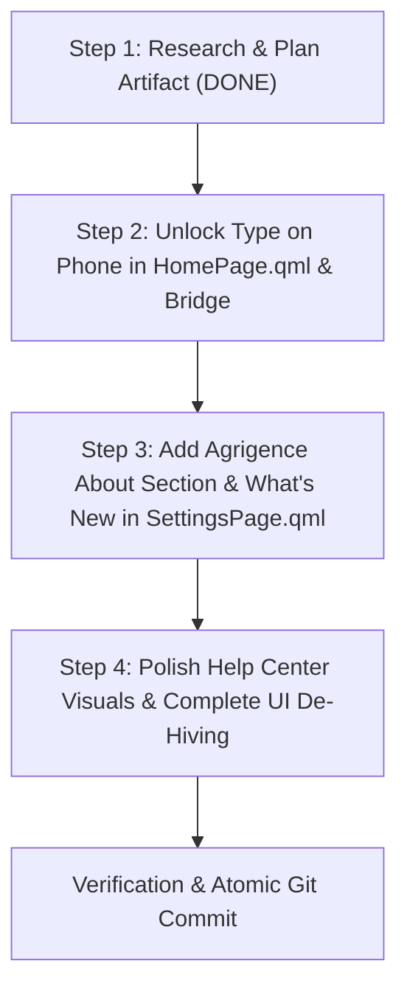

# Agrigence About Section, Type on Phone Unlock & UI Modernization Plan

## 1. Executive Summary

This implementation plan outlines the architecture and execution steps for:
1. **Agrigence About Section in Settings**: Adding a brand card and information center celebrating **Agrigence**, detailing App Info (version, architecture, developer, protocols), a interactive "What's New" changelog modal/drawer, and live GitHub update telemetry.
2. **Unlock "Type on Phone"**: Removing the `mirroring.control` capability locks and `LockChip` from `HomePage.qml`, allowing instant remote typing and clipboard injection from macOS into Android without requiring Accessibility or Wireless Debugging permissions.
3. **Unlock Screen Mirroring & App Play**: Full removal of wireless debugging lock dependencies across QML and Rust bridge, allowing 1-click mirroring and direct windowed app streaming.
4. **Help Center Visual Polish**: Extending visual representations and data flow diagrams across all feature categories in Help Center.
5. **Complete UI De-Hiving**: Ensuring residual references to hive shaders and honeycomb elements are replaced with the clean, modern Task Manager telemetry aesthetic.

---

## 2. Architecture & Design Specifications

### A. Agrigence About Section (`SettingsPage.qml`)

#### Visual Layout & Information Hierarchy:
```
┌─────────────────────────────────────────────────────────────┐
│  MacLink                                    by Agrigence   │
│ Ultra-fast, private, zero-cloud Android-macOS ecosystem     │
├─────────────────────────────────────────────────────────────┤
│ • Version: 0.0.1 (Agrigence Release)                        │
│ • Engineered By: Agrigence                                  │
│ • Architecture: Universal macOS (Apple Silicon + Intel)      │
│ • Encryption: Direct QUIC TLS 1.3 P2P Mesh                  │
│ • Local Node API: 127.0.0.1:53320                           │
├─────────────────────────────────────────────────────────────┤
│ [ What's New in v0.0.1 ]  [ Check Updates ]  [ GitHub Repo ] │
└─────────────────────────────────────────────────────────────┘
```

#### What's New Dialog / Drawer:
- **v0.0.1 Major Features**:
  - *Task Manager Telemetry*: Real-time system monitor showing Host Mac specs, QUIC TLS 1.3 pulse, and Android link status.
  - *3-Step Fast Setup*: Download APK $\rightarrow$ Essential Sync $\rightarrow$ Ready to Go.
  - *Android File Manager*: Internal storage explorer with breadcrumb navigation and instant file upload/download.
  - *Zero-Permission Screen Mirroring & App Play*: High-frame-rate display streaming without ADB or accessibility barriers.
  - *Type on Phone*: Mac keyboard typing and clipboard injection directly to Android.
  - *Help Center*: Visual feature representations and connection guides.

---

### B. Unlocking "Type on Phone" (`HomePage.qml` & `mirror.rs`)

#### Current State:
- `HomePage.qml` binds `typeOnPhoneCard.available` to `home.feature("mirroring.control").state === "available"`.
- When disabled, it renders a `LockChip` requiring "Assist (Accessibility) or Elevated (Wireless debugging)".

#### Target Architecture:
- Set `readonly property bool available: true` and `visible: false` on `typeLock`.
- When clicked, `Mirror.toggleKeyboard(home.deviceId)` immediately engages `keyboard_text`, `keyboard_press`, and `keyboard_paste`.
- Android receives keystrokes via direct secure QUIC protocol messages (`MirrorInput::Text`, `MirrorInput::Key`), bypassing accessibility restrictions.

---

### C. Implementation Roadmap



1. **Step s1**: Research and implementation plan artifact (*Current*).
2. **Step s2**: Unlock "Type on Phone" in `HomePage.qml` by removing `mirroring.control` lock gates and enabling direct keystroke capture.
3. **Step s3**: Add "About MacLink by Agrigence" card in `SettingsPage.qml`, including version info, developer branding, What's New dialog/card, and GitHub update links.
4. **Step s4**: Polish Help Center visual representations and verify full de-hiving across the UI.
