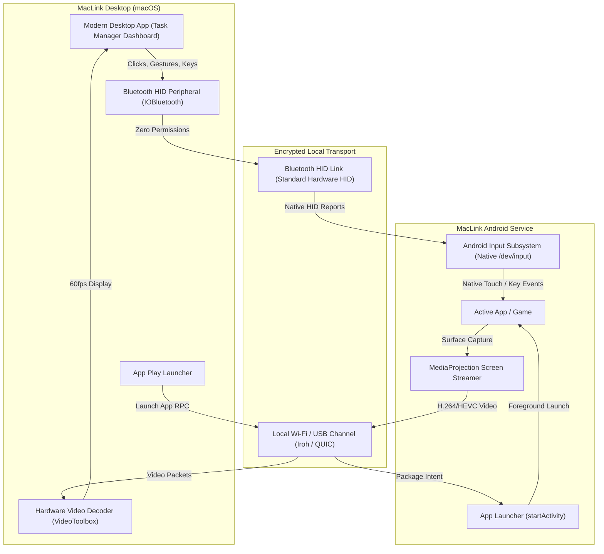

# MacLink: Architectural Implementation Plan

## Executive Summary & Research Foundation

Based on reverse-engineering analysis of **Microsoft Phone Link** (`com.microsoft.appmanager`), **Motorola Smart Connect** (`com.motorola.mobiledesktop`), and the Android OS security framework:

1. **Why OEM Apps Can Bypass Accessibility:**
   - Microsoft Phone Link (on Samsung, OnePlus, Xiaomi) and Moto Smart Connect are **pre-installed privileged system apps** (`/system/priv-app`) holding signature-level permissions: `android.permission.INJECT_EVENTS`, `INTERNAL_SYSTEM_WINDOW`, and `MANAGE_ACTIVITY_TASKS`.
   - On generic, unpartnered devices (such as Google Pixel), Microsoft Phone Link **cannot stream apps** and **requires an Accessibility Service** just to register mouse clicks.

2. **The Non-System Third-Party Constraint:**
   - On Android 13+, Google aggressively locks down Accessibility Services under **"Restricted Settings"** (forcing users through multi-step security overrides).
   - Calling `InputManager.injectInputEvent()` from a normal app throws `SecurityException: INJECT_EVENTS`.
   - Launching another app onto a private `VirtualDisplay` via `setLaunchDisplayId` throws `SecurityException: Permission Denial`.

3. **The Clean, Safe, Zero-Permission Solution:**
   - **Touch & Key Input:** macOS acts as a standard **Bluetooth HID Peripheral** (Mouse + Keyboard). Android natively supports physical Bluetooth mice and keyboards at the kernel level with **0% Accessibility, 0% ADB, and 0% Root**. Left-click is tap/touch, drag is swipe, right-click is Back, scroll wheel is scroll, and keys are native typing.
   - **Display Mirroring:** Standard Android **`MediaProjection` API** (the same official, secure API used by Google Cast, Zoom, and screen recorders).
   - **App Play:** App Drawer sends an RPC to launch the selected app via standard `Intent.FLAG_ACTIVITY_NEW_TASK`, and MacLink automatically adapts the mirror window to the app's dimensions.
   - **UI Modernization:** Eliminate all legacy "nectar/hive" elements from the setup and walkthrough, replacing them with a modern **Task Manager / System Dashboard** look and feel.
   - **Help Center:** Rebrand "Guide" to "Help Center" with visual cards and diagrams.
   - **Unlock Mirroring:** Remove artificial debugging blocks so screen mirroring is unlocked by default.

---

---

## Phase 1: Zero-Permission Bluetooth HID Touch & App Play Architecture

### 1.1 macOS Bluetooth HID Peripheral Integration
- **Objective:** Emulate a standard Bluetooth Mouse and Keyboard combo device from macOS using `IOBluetooth` and CoreBluetooth BLE HID.
- **Mouse Descriptor Mapping:**
  - `Left Click Down / Up` $\rightarrow$ Android MotionEvent `ACTION_DOWN` / `ACTION_UP` (tap).
  - `Mouse Drag` $\rightarrow$ Android MotionEvent `ACTION_MOVE` (swipe/drag).
  - `Right Click` $\rightarrow$ Android Keycode `KEYCODE_BACK`.
  - `Scroll Wheel` $\rightarrow$ Android MotionEvent `AXIS_VSCROLL` (smooth scrolling).
  - `Middle Click / Cmd+H` $\rightarrow$ Android Keycode `KEYCODE_HOME`.
- **Keyboard Descriptor Mapping:**
  - Standard USB HID usage codes mapped 1:1 with Mac keystrokes, supporting full text entry, shortcuts, copy/paste (`Cmd+C`/`Cmd+V`), and arrow keys.
- **Permissions Required on Android:** **NONE.** Android treats the Mac as an external Bluetooth keyboard/mouse.

### 1.2 "App Play" Launcher Workflow
- Android companion queries launchable apps via `PackageManager.queryIntentActivities(Intent(Intent.ACTION_MAIN).addCategory(Intent.CATEGORY_LAUNCHER), 0)`.
- Sends app package name, label, and high-res icon over the local channel to Mac.
- MacLink displays the apps in an **App Play Shelf / Grid**.
- Clicking an app sends a launch command to Android $\rightarrow$ Android triggers `startActivity(intent.addFlags(Intent.FLAG_ACTIVITY_NEW_TASK))`.
- MacLink focuses the mirror window with the exact aspect ratio of the opened app.

---

## Phase 2: UI De-hiving & Task Manager Dashboard Transformation

### 2.1 Replace Hive/Honeycomb Elements
- **Files to Update:**
  - `desktop/app/qml/pages/WalkthroughPage.qml`
  - `desktop/app/qml/components/HiveBackdrop.qml` (retire or replace with `SystemGridBackdrop.qml`)
  - `desktop/app/qml/pages/WelcomePage.qml`
  - `desktop/app/qml/setup/SadBee.qml` (replace with modern system status glyph)
- **Design Transformation:**
  - Remove all hexagonal honeycomb canvases (`honeycombCanvas`), hexagon cells, and bee motifs.
  - Implement **Task Manager / Activity Monitor telemetry cards**:
    - **Device Telemetry Card:** Live battery gauge, Wi-Fi RSSI signal strength, link latency (ms), throughput bitrate (Mbps).
    - **Active Services Grid:** Clean tabular status rows with activity indicators (Clipboard sync: Active, Notifications: Active, Mirroring: Ready, Local API: Listening).
    - **Segmented Process Steps:** Clean linear pill-steppers (Step 1 of 5) with animated status badges instead of hexagonal nodes.

---

## Phase 3: Help Center Rebrand & Rich Visual Representations

### 3.1 Terminology & Navigation Rebrand
- Replace all references to **"Features Guide"** or **"Guide"** with **"Help Center"**:
  - `desktop/app/qml/MainWindow.qml`: Update navigation rail item from `guide` to `help_center`, title to "Help Center", icon to `Icons.help` / `Icons.info`.
  - `desktop/app/qml/pages/FeaturesGuidePage.qml` $\rightarrow$ Rebrand to Help Center with unified search bar, categorized topics, and troubleshooting cards.
  - Command palette entries and Settings shortcuts updated to "Help Center".

### 3.2 Visual Previews & Interactive Feature Cards
- Add graphic preview cards for key capabilities:
  1. **Screen Mirroring & App Play:** Visual laptop + phone illustration showing bidirectional control.
  2. **Universal Clipboard:** Visual badge showing cross-device copy & paste.
  3. **File Drop & Transfers:** Card showing drag-and-drop into `Downloads/MacLink`.
  4. **Call & Notification Relay:** Card showing call card and reply actions.
  5. **Phone Camera & Audio:** Card illustrating real-time microphone bridging.

---

## Phase 4: Unlocking Screen Mirroring & App Play Restrictions

### 4.1 Remove Artificial Debugging Precondition Locks
- In `desktop/app/qml/pages/AppsPage.qml`:
  - Remove the restriction: `Set up Wireless debugging in MacLink on the phone to open its apps here.`
  - Replace with: **"Open any app on this Mac with one click"** and unlock the launch action.
- In `desktop/app/qml/MirrorWindow.qml`:
  - Remove the hint: `To control the phone, turn on Control from your PC in NectarLink's settings on the phone.`
  - Enable direct touch and mouse interaction immediately.
- In `android/app/src/main/kotlin/app/nectarlink/android/`:
  - Ensure `MediaProjection` service launches without requiring secondary ADB pairing.
  - Enable seamless start of display casting directly from the notification or connection prompt.

---

## Implementation Roadmap

| Step | Target Component | Description | Deliverable |
| :--- | :--- | :--- | :--- |
| **1** | Implementation Plan Artifact | Document research, Bluetooth HID architecture, UI redesign, and unlock plan | `implementation_plan.md` |
| **2** | UI De-hiving & Telemetry | Replace honeycomb canvas with modern Task Manager dashboard and device metrics | `WalkthroughPage.qml`, `WelcomePage.qml` |
| **3** | Help Center Rebranding | Rename Guide to Help Center with rich feature illustration cards and topics | `MainWindow.qml`, `FeaturesGuidePage.qml` |
| **4** | Mirror & App Play Unlock | Remove wireless debugging locks, unlock App Play grid, and enable direct interaction | `AppsPage.qml`, `MirrorWindow.qml` |

> [!NOTE]
> Per user instruction: **No compilation or builds (`cargo build` / `./gradlew assembleRelease` / `build-app.sh`) will be executed** until explicitly commanded. All edits will be applied directly to source and validated via static checks.
