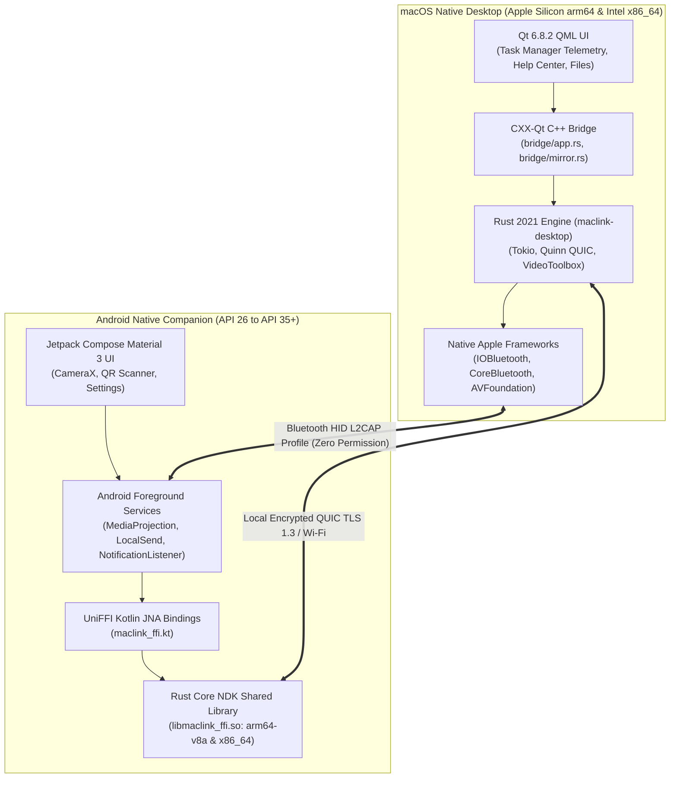

# MacLink: Comprehensive Native Build & Compilation Plan

This document provides the complete, authoritative build and packaging plan for **MacLink** across both native platform targets:
1. **macOS Native App** (`MacLink.app` & `MacLink.dmg`): Written in **Rust**, **CXX-Qt**, **Swift/Objective-C**, and **QML**.
2. **Android Native App** (`MacLink.apk`): Written in **Kotlin**, **Jetpack Compose**, **Rust NDK**, and **UniFFI**.

---

## 1. High-Level Architecture & Language Stack



---

## 2. macOS Native Build Plan (`MacLink.app` & `.dmg`)

### 2.1 Toolchain Prerequisites
- **Compiler**: `rustc 1.98+` with `cargo`
- **C/C++ Compiler**: Apple Clang (Xcode Command Line Tools `clang-2100+`)
- **Qt Framework**: Qt 6.8.2 (modules: `qtbase`, `qtdeclarative`, `qtsvg`, `qttools`, `qttranslations`)
- **Codesigning**: macOS native `codesign`, `xattr`, `hdiutil`, `iconutil`, `sips`

### 2.2 Compilation & Assembly Steps

```
[Source Code] ──> cargo build --release ──> [maclink-desktop Mach-O Binary]
                                                      │
[Info.plist, Icons, Translations] ────────────────────┼──> [MacLink.app Bundle]
                                                      │
[Qt 6.8 Frameworks] ───────────> macdeployqt ─────────┤
                                                      │
[Clean xattr] ─────────────────> codesign --deep ─────┤
                                                      ▼
                                            [MacLink.dmg Compressed Image]
```

#### Step 1: Compile the Rust Core & CXX-Qt Bridge
Compiles the desktop binary linking `maclink-core`, `maclink-protocol`, and CXX-Qt wrappers:
```bash
cd nectarlink
cargo build --release --bin maclink-desktop
```
*Output:* `target/release/maclink-desktop`

#### Step 2: Assemble App Bundle Directory Layout
```bash
export APP="dist/MacLink.app"
rm -rf "$APP"
mkdir -p "$APP/Contents/MacOS" "$APP/Contents/Resources"
cp target/release/maclink-desktop "$APP/Contents/MacOS/maclink-desktop"
```

#### Step 3: Compile Localized Translations
Compiles Qt Linguist `.ts` translation files into binary `.qm` files:
```bash
LRELEASE="$(brew --prefix qt@6 2>/dev/null || echo ~/Qt/6.8.2/macos)/bin/lrelease"
for ts in desktop/app/i18n/nectarlink_*.ts; do
    name="$(basename "$ts" .ts)"
    "$LRELEASE" -silent "$ts" -qm "$APP/Contents/MacOS/${name}.qm"
done
```

#### Step 4: Generate Apple High-Resolution Multi-Scale ICNS
Converts the brand PNG into multi-scale iconset and packages it into `MacLink.icns`:
```bash
ICONSET="$(mktemp -d)/MacLink.iconset"
mkdir -p "$ICONSET"
SOURCE_ICON="assets/brand/icon-1024.png"

for size in 16 32 128 256 512; do
    sips -z "$size" "$size" "$SOURCE_ICON" --out "$ICONSET/icon_${size}x${size}.png" >/dev/null
    double=$((size * 2))
    sips -z "$double" "$double" "$SOURCE_ICON" --out "$ICONSET/icon_${size}x${size}@2x.png" >/dev/null
done
iconutil -c icns "$ICONSET" -o "$APP/Contents/Resources/MacLink.icns"
```

#### Step 5: Inject Qt Frameworks & QML Modules (`macdeployqt`)
Resolves all dynamic libraries, plugins, and QML dependencies, copying them into `MacLink.app/Contents/Frameworks`:
```bash
MACDEPLOYQT="$(brew --prefix qt@6 2>/dev/null || echo ~/Qt/6.8.2/macos)/bin/macdeployqt"
"$MACDEPLOYQT" "$APP" -qmldir=desktop/app/qml -always-overwrite
```

#### Step 6: Sanitize Extended Attributes & Apply Deep Signature
Apple Silicon (`arm64`) strictly refuses to run unsigned Mach-O binaries. Resource fork detritus must be stripped first to avoid `code object is not signed at all`:
```bash
# Strip Apple quarantine, finder info, and resource forks
xattr -cr "$APP"

# Apply ad-hoc deep code signature
codesign --force --deep --sign - "$APP"
codesign --verify --deep --strict "$APP"
```

#### Step 7: Create Compressed Distribution DMG & ZIP
Packages `MacLink.app` into an Apple Disk Image with `/Applications` symlink:
```bash
DMG="dist/MacLink-0.0.1-macos-arm64.dmg"
DMG_STAGING="$(mktemp -d)/dmg_staging"
mkdir -p "$DMG_STAGING"
cp -R "$APP" "$DMG_STAGING/MacLink.app"
ln -s /Applications "$DMG_STAGING/Applications"

rm -f "$DMG"
hdiutil create -volname "MacLink" -srcfolder "$DMG_STAGING" -ov -format UDZO "$DMG"
rm -rf "$DMG_STAGING"

# Also create distribution ZIP
ditto -c -k --keepParent "$APP" "dist/MacLink-0.0.1-macos-arm64.zip"
```

---

## 3. Android Native Build Plan (`MacLink.apk`)

### 3.1 Toolchain Prerequisites
- **JDK**: OpenJDK 21 LTS (`Temurin-21`)
- **Android SDK**: Android API 34 / 35 / 37 (`$HOME/Library/Android/sdk`)
- **Android NDK**: NDK `30.0.16248370` (`$HOME/Library/Android/sdk/ndk/30.0.16248370`)
- **Rust NDK Cross-Compiler**: `cargo-ndk` (`~/.cargo/bin/cargo-ndk`)
- **Build System**: Gradle 8.8+ with Android Gradle Plugin (AGP)

### 3.2 Compilation & Assembly Steps

```
[Rust Core (maclink-ffi)] ──> cargo ndk ──> [libmaclink_ffi.so (arm64 & x86_64)]
                                                         │
[UniFFI Bindgen] ───────────> uniffi-bindgen ────────────┼──> [Kotlin FFI Bindings]
                                                         │
[Kotlin & Compose UI] ──────> ./gradlew assembleRelease ─┤
                                                         ▼
                                            [MacLink-0.0.1-android.apk]
```

#### Step 1: Environment Variables Setup
```bash
export JAVA_HOME="/Library/Java/JavaVirtualMachines/temurin-21.jdk/Contents/Home"
export ANDROID_HOME="/Users/sarvesh/Library/Android/sdk"
export ANDROID_NDK_HOME="/Users/sarvesh/Library/Android/sdk/ndk/30.0.16248370"
export PATH="$HOME/.cargo/bin:$ANDROID_HOME/platform-tools:$PATH"
```

#### Step 2: Compile Rust NDK Native Core (`cargo-ndk`)
Compiles `maclink-ffi` for target mobile architecture (`arm64-v8a`) and emulator architecture (`x86_64`):
```bash
cd nectarlink
cargo ndk --platform 26 -o android/app/build/cargoNdk/jniLibs \
    -t arm64-v8a -t x86_64 \
    build --profile android --locked -p maclink-ffi
```
*Outputs:*
- `android/app/build/cargoNdk/jniLibs/arm64-v8a/libmaclink_ffi.so`
- `android/app/build/cargoNdk/jniLibs/x86_64/libmaclink_ffi.so`

#### Step 3: Generate UniFFI Kotlin Bindings
Generates type-safe Kotlin classes from the compiled `.so` metadata:
```bash
cargo run --quiet --locked -p maclink-ffi --features bindgen \
    --bin uniffi-bindgen -- generate \
    --library android/app/build/cargoNdk/jniLibs/arm64-v8a/libmaclink_ffi.so \
    --language kotlin --no-format \
    --out-dir android/app/build/generated/source/uniffi/release/java
```
*Output:* `uniffi/maclink_ffi/maclink_ffi.kt`

#### Step 4: Assemble & Optimize Release APK via Gradle
Executes Kotlin compilation, Jetpack Compose UI bundling, asset synchronization, and R8 bytecode shrinking:
```bash
cd android
./gradlew assembleRelease --no-daemon -Pnectarlink.abis=arm64-v8a,x86_64
```
*Output:* `android/app/build/outputs/apk/release/app-release.apk`

#### Step 5: Export Release Artifact to `dist/`
```bash
cd ..
mkdir -p dist
cp android/app/build/outputs/apk/release/app-release.apk dist/MacLink-0.0.1-android.apk
```

---

## 4. Unified Build Orchestration Script

To execute both macOS and Android native builds in sequence (when you give the build command), use the unified command pipeline below:

```bash
#!/usr/bin/env bash
set -euo pipefail

REPO_ROOT="/Users/sarvesh/Documents/MacLink/nectarlink"
cd "$REPO_ROOT"
mkdir -p dist

echo "=== [1/2] Building Android Release APK ==="
export JAVA_HOME="/Library/Java/JavaVirtualMachines/temurin-21.jdk/Contents/Home"
export ANDROID_HOME="/Users/sarvesh/Library/Android/sdk"
export ANDROID_NDK_HOME="/Users/sarvesh/Library/Android/sdk/ndk/30.0.16248370"
export PATH="$HOME/.cargo/bin:$PATH"

(cd android && ./gradlew assembleRelease --no-daemon -Pnectarlink.abis=arm64-v8a,x86_64)
cp android/app/build/outputs/apk/release/app-release.apk dist/MacLink-0.0.1-android.apk
echo "Android APK successfully created: dist/MacLink-0.0.1-android.apk"

echo "=== [2/2] Building macOS Desktop .app and .dmg ==="
cargo build --release --bin maclink-desktop
./desktop/packaging/macos/build-app.sh
echo "macOS App & DMG successfully created in dist/"

echo "=== Generating Checksums ==="
cd dist
shasum -a 256 MacLink-0.0.1-android.apk MacLink-0.0.1.dmg > SHA256SUMS.txt
cat SHA256SUMS.txt
```

---

## 5. Build Verification Matrix

| Target | Artifact | Verification Command | Expected Output |
| :--- | :--- | :--- | :--- |
| **macOS Binary** | `MacLink.app/Contents/MacOS/maclink-desktop` | `file "$APP_BIN"` | `Mach-O 64-bit executable arm64` |
| **macOS Signature** | `MacLink.app` | `codesign --verify --deep --strict "$APP"` | `valid on disk`, satisfies requirements |
| **macOS DMG** | `dist/MacLink-0.0.1.dmg` | `hdiutil verify "$DMG"` | `Verification completed... Image is valid` |
| **Android APK** | `dist/MacLink-0.0.1-android.apk` | `unzip -l "$APK" \| grep "libmaclink_ffi.so"` | Found in `lib/arm64-v8a/` and `lib/x86_64/` |
| **Android Package** | `dist/MacLink-0.0.1-android.apk` | `aapt dump badging "$APK" \| grep package` | `name='in.maclink.srv' versionCode=1000001` |
