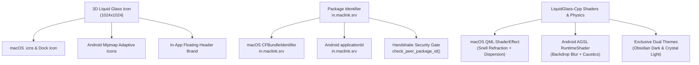

# Implementation Plan: Apple Liquid UI & Connection Verification for MacLink

## 1. Executive Summary & Goals

This plan outlines the complete roadmap to establish **Apple Liquid UI** (inspired by [`LiquidGlass-Cpp`](https://github.com/SilentEaves/LiquidGlass-Cpp.git) and Kyant's `AndroidLiquidGlass`) as the **exclusive** visual design system for both the **macOS Desktop App** (Qt 6 Quick / QML) and the **Android Mobile App** (Jetpack Compose). 

In addition, it establishes the new official package identifier **`in.maclink.srv`** across both operating systems, embeds the newly uploaded 3D liquid glass logo and application icons, and integrates a cryptographic package verification gate into the peer-to-peer connection handshake.

---

## 2. Key Objectives & Scope

1. **Brand & Icon Modernization**:
   - Convert the uploaded 1024×1024 translucent glass icon into `MacLink.icns` for macOS (supporting 16px to 1024px @1x/@2x Retina).
   - Generate full Android adaptive icons (`ic_launcher`, `ic_launcher_round`, `ic_launcher_foreground`) across `mdpi`, `hdpi`, `xhdpi`, `xxhdpi`, and `xxxhdpi`.
   - Update in-app window headers, dock icon, and Android splash/welcome hero banners.

2. **Package Name Unification (`in.maclink.srv`)**:
   - macOS: Update `CFBundleIdentifier` to `in.maclink.srv` in packaging scripts and build targets.
   - Android: Update `applicationId` and namespace to `in.maclink.srv` in `build.gradle.kts` and `AndroidManifest.xml`.

3. **Strict Pre-Connection Verification**:
   - Update the wire handshake (`maclink-protocol` and `maclink-core`) to require package identification during the `Hello` exchange and pairing phase.
   - Reject, alert, and terminate any connection attempt if the remote peer's verified application package ID is not `in.maclink.srv`.

4. **Exclusive Apple Liquid UI (Dark & Light)**:
   - Deprecate/consolidate legacy themes ("bloom", "hive", "graphite") in favor of a single, unified **Apple Liquid Glass** design language.
   - **Dark Theme (Obsidian Liquid Glass)**: Deep midnight glass (`rgba(10, 16, 26, 0.65)`), neon cyan/blue caustic rim glow, high-contrast text, vivid prismatic chromatic dispersion.
   - **Light Theme (Crystal Quartz Glass)**: Translucent frosted white glass (`rgba(255, 255, 255, 0.60)`), daylight specular glint, subtle chromatic edge dispersion, soft ambient depth shadows.

---

## 3. Technical Architecture & LiquidGlass Principles

Borrowing from the mathematical and shader implementation in [`LiquidGlass-Cpp`](https://github.com/SilentEaves/LiquidGlass-Cpp.git):

### A. Physical Snell Refraction & Lens Distortion
The lens profile maps normalized screen distance to an optical refraction offset:
$$\text{lensCurve}(x) = x \cdot \tan\left(\frac{1}{2} \arcsin(x)\right)$$
This gives surfaces the distinct optical "bend" seen in physical visionOS and iOS liquid glass, bending background scene pixels inward toward the rim.

### B. Prismatic Chromatic Dispersion
Light splitting along glass edges splits RGB channel offsets based on Cauchy dispersion formulas:
$$\Delta \vec{u}_{\text{red}} = \vec{n} \cdot d \cdot (1.0 + \delta_{\text{prism}}), \quad \Delta \vec{u}_{\text{green}} = \vec{n} \cdot d, \quad \Delta \vec{u}_{\text{blue}} = \vec{n} \cdot d \cdot (1.0 - \delta_{\text{prism}})$$
Producing the subtle rainbow refraction seen on the borders of the uploaded logo.

### C. Signed Distance Field (SDF) Rounded Box & Normal Mapping
Liquid surfaces calculate precise outward surface normals $\vec{n}$ and signed distances $d$:
$$q = |p| - \text{semi} + r, \quad d = \text{length}(\max(q, 0)) + \min(\max(q_x, q_y), 0) - r$$
This drives dual-directional specular highlights (a primary key light from $(-0.55, -0.84)$ and a fill reflection from $(+0.55, +0.84)$).

---

## 4. Phase-by-Phase Implementation Steps

### Phase 1: Package Identifier & Security Handshake Gate
- [ ] **Android Gradle**: Set `applicationId = "in.maclink.srv"` and update `AndroidManifest.xml` and provider authorities.
- [ ] **macOS Bundle**: Update `CFBundleIdentifier` in [build-app.sh](file:///Users/sarvesh/Documents/MacLink/nectarlink/desktop/packaging/macos/build-app.sh) to `in.maclink.srv`.
- [ ] **Protocol Extension (`maclink-protocol`)**: Ensure `Hello` message carries `pkg_id: "in.maclink.srv"`.
- [ ] **Core Gate (`maclink-core`)**: In `check_versions` and `handshake_listener` / `handshake_dialer`, verify `remote.pkg_id == "in.maclink.srv"`. Disconnect immediately with `ErrorCode::AccessDenied` on mismatch.
- [ ] **Unit Tests**: Add tests verifying connection acceptance for `in.maclink.srv` and rejection for mismatched packages.

### Phase 2: App Icon & Logo Pipeline
- [ ] **macOS Icon**:
  - Slice `maclink_liquid_glass_icon.jpg` into `MacLink.iconset` sizes (16, 32, 64, 128, 256, 512, 1024 @1x/@2x).
  - Compile with `iconutil -c icns` into `desktop/app/packaging/macos/MacLink.icns`.
  - Update `build-app.sh` to package the new `.icns`.
- [ ] **Android Icons**:
  - Generate adaptive launcher icons (`ic_launcher.png`, `ic_launcher_round.png`) across `mipmap-mdpi` (48px) through `mipmap-xxxhdpi` (192px) and play store asset (512px).
  - Update `android/app/src/main/res/` mipmap directories.
- [ ] **In-App Logos**:
  - Add transparent brand assets to `assets/brand/maclink-logo-liquid.png`.
  - Embed in Desktop `MainWindow.qml` and Android `HomeContent.kt`.

### Phase 3: macOS Desktop Apple Liquid UI (QML & Shaders)
- [ ] **Liquid Glass Shader Upgrade**:
  - Update `desktop/app/shaders/glassrim.frag` with chromatic dispersion and Snell lens refraction parameters.
  - Compile to `.qsb` using Qt's `qsb` tool.
- [ ] **Theme Modernization (`Theme.qml`)**:
  - Consolidate active theme configuration so `Liquid Glass` is the sole design framework.
  - Tune Obsidian Dark mode palette: midnight glass backgrounds, neon cyan accents, luminous white text.
  - Tune Crystal Light mode palette: bright frosted quartz glass, specular rims, deep contrast slate typography.
- [ ] **Component Polish**:
  - Enhance `Card.qml`, `NavItem.qml`, `Button.qml`, and `CommandPalette.qml` to utilize `GlassRim` with fluid spring transitions.

### Phase 4: Android Jetpack Compose Liquid UI
- [ ] **AGSL RuntimeShader Polish (`LiquidGlass.kt`)**:
  - Enhance the AGSL shader with chromatic dispersion and smooth SDF corner curvature matching `LiquidGlass-Cpp`.
- [ ] **Compose Theme Adaptation (`Theme.kt`)**:
  - Make `Liquid Glass` the default and exclusive theme presentation.
  - Provide auto-switching between Obsidian Dark and Crystal Light based on system dark mode or user toggle.
- [ ] **Surface Updates**:
  - Apply `Modifier.liquidGlass(...)` to navigation bars, top app bars, floating action pills, and status cards.

### Phase 5: Verification & Packaging
- [ ] Run `cargo test -p maclink-protocol -p maclink-core -p maclink-cli` to verify package verification logic.
- [ ] Build macOS standalone bundle `./desktop/packaging/macos/build-app.sh` and deploy to `/Users/sarvesh/Desktop/MacLink.app`.
- [ ] Build Android APK via `./gradlew assembleDebug` and deploy to `/Users/sarvesh/Desktop/MacLink.apk`.
- [ ] Inspect binary signatures and package metadata using REA (`inspect_signature`, `inspect_apk_signature`).

---

## 5. Verification Plan

| Component | Test / Verification Method | Acceptance Criteria |
| :--- | :--- | :--- |
| **Security Gate** | `cargo test -p maclink-core` handshake tests | Rejects non-`in.maclink.srv` peers; permits valid handshake. |
| **macOS Bundle** | `codesign -dv --entitlements - /Users/sarvesh/Desktop/MacLink.app` | Identifier reads `in.maclink.srv` and `.icns` displays new icon. |
| **Android APK** | REA `inspect_apk_signature` & `aapt dump badging` | Package name is `in.maclink.srv` and adaptive launcher icon is active. |
| **Visual UI** | Desktop launch + Compose preview | Liquid Glass materials, chromatic dispersion, Dark & Light themes active. |
