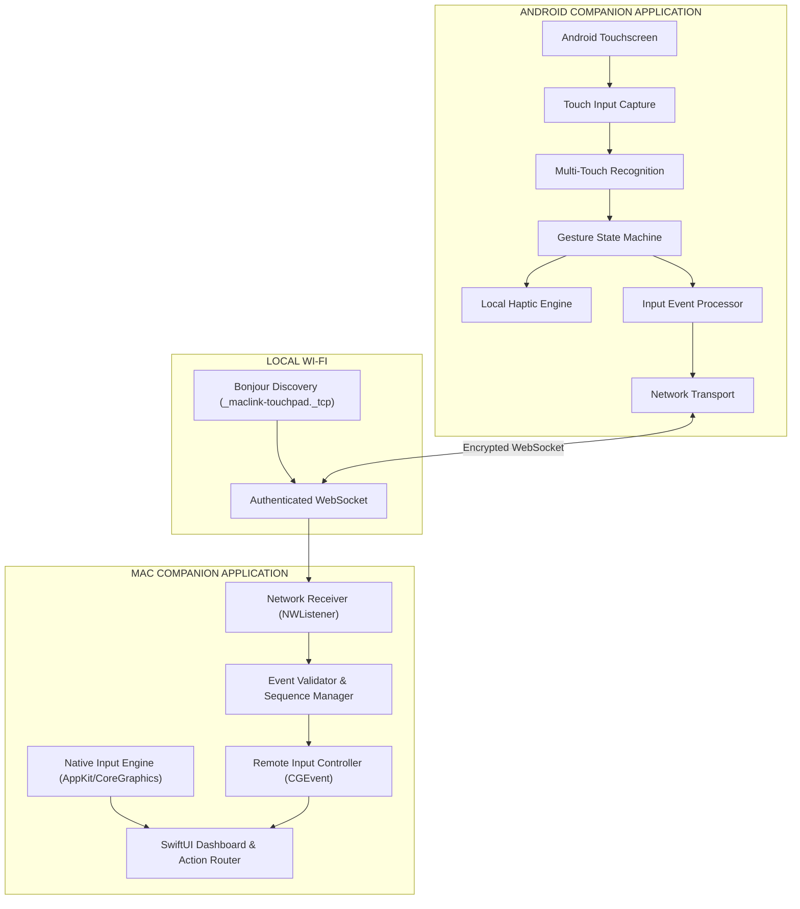

# System Architecture

## 1. System Vision & Context
The ecosystem enables bi-directional input intelligence and remote trackpad capability across macOS and Android platforms.

## 2. Core Architectural Pillars
1. **Decoupled Haptics:** The Android tactile engine runs immediately in the touch capture lifecycle. Network latency, socket backpressure, or connection drops never delay haptic clicks.
2. **Fail-Safe Release Policy:** If the Wi-Fi connection drops, the Mac Companion immediately issues synthetic mouse-up and modifier-up events, preventing stuck inputs.
3. **Hardware Truth:** The Mac Companion distinguishes between trackpads (which support Force Touch) and Magic Mouse (which does not). It never fakes unsupported hardware capabilities.
4. **Rate-Limited Monotonic Protocol:** All input events are sequenced monotonically and validated against clock drift and replay bounds.

