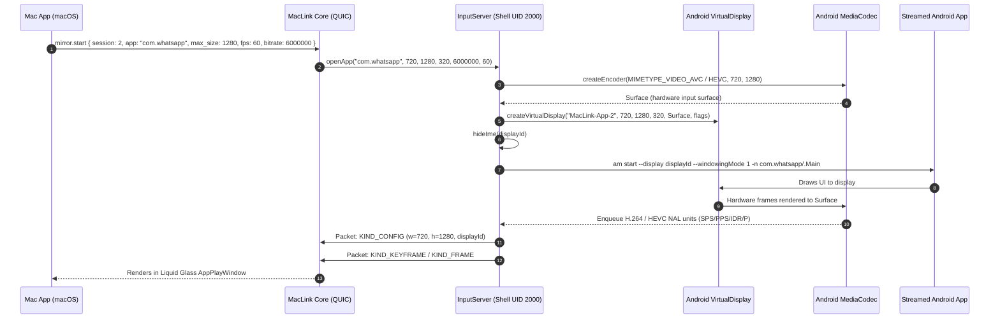

# MacLink: App Play & PC Desktop Mode Architecture Specification
> Reverse-Engineered from Motorola Smart Connect (Ready For) & Native macOS/Android Design
> Status: **Draft Specification** | License: CC BY 4.0 | Date: 2026-11-01

---

## 1. Executive Summary & Comparative Extraction

Using REA reverse-engineering tools on **Motorola Smart Connect** (`Smart Connect.apk` v08.0.0 and `SmartConnect_setup_08.0.0.002.001.exe` containing `AppStream.dll`, `superlink20.dll`, `RfaRpc.dll`), we analyzed the exact technical mechanics used to deliver **PC Mode** (Android Desktop Launcher on secondary display) and **App Play** (individual sandboxed Android application streaming in discrete floating windows on PC).

This document specifies how **MacLink** implements these capabilities natively between **Android** and **macOS**, maintaining MacLink's high-efficiency QUIC transport (`iroh`), low-latency hardware video acceleration (Apple VideoToolbox + Android MediaCodec), and distinctive **Apple Liquid Glass UI** design language.

### Comparative Feature Matrix

| Feature | Motorola Smart Connect (PC/Android) | MacLink Implementation (macOS/Android) |
|---|---|---|
| **App Virtualization** | `VirtualDeviceManager` / `ScVirtualDevice` + `DisplayManager.createVirtualDisplay` | Dual-mode: Android 13+ `VirtualDeviceManager` (`VDM`) when available; Elevated Shell `DisplayManager.createVirtualDisplay` (`AppDisplay.kt`) fallback. |
| **PC Desktop Mode** | `com.motorola.mobiledesktop.DesktopModeLauncherActivity` launched onto secondary display | Native Android Multi-window / Freeform launcher activity on secondary display (`launchDisplayId`) streamed to full Mac desktop window. |
| **App Play (Discrete Windows)** | `DiscreteWindowDecorator` in `AppStream.dll` (Win32/Direct3D/SDL2) | Multi-window `AppPlayWindow.qml` with Apple **Liquid Glass UI**, Metal-accelerated video view, traffic lights, and pin/rotate controls. |
| **Dynamic Window Resize** | `AppResizeData` -> `VirtualDisplay.resize()` -> dynamic Android activity layout | `MirrorResize` (`session, width, height`) -> `VirtualDisplay.resize(w, h, dpi)` with zero app restarts. |
| **Video Transport & Codecs** | WebRTC (`superlink20.dll`), H.264 / H.265 | Iroh QUIC multiplexed streams (`mirror` svc, `video` op), H.264 / HEVC (H.265) / AV1. |
| **macOS Video Decoding** | N/A (Windows D3D11 / MFT only) | Apple **VideoToolbox** (`VTDecompressionSession`) zero-copy decode to Metal `CVPixelBufferRef` inside Qt Quick. |
| **Audio Routing** | `R4AudioStreamingProxy` + SDL2 (`AudioPlaybackCapture`) | Android `AudioPlaybackCaptureConfiguration` (Android 10+) streaming 48 kHz stereo PCM over QUIC to macOS CoreAudio. |
| **Input & IME Sync** | `AVR4InputMsgTouchEvent`, `PCIMEHandlerAdapter` | Normalized float coordinates (`MirrorInput::Touch`), macOS Trackpad Gestures (`Scroll`), and direct macOS IME text commitment (`MirrorInput::Text`). |

---

## 2. Android Subsystem Architecture

### 2.1 Virtual Display Lifecycle (`AppDisplay.kt` & `VDM`)

Every streamed app session (`session != 0`) is allocated an independent display instance:



### 2.2 Dynamic Resizing Protocol (`MirrorResize`)

When the user on macOS drags the resize handle of an App Play window:

1. **Debounced Resize Event:** macOS QML calculates the new pixel size clamped to 16-pixel multiples (e.g., $800 \times 1424$).
2. **Control Message:** Mac sends `mirror.resize { session: 2, width: 800, height: 1424 }`.
3. **Display Adaptation:** `AppDisplay.kt` catches `nextSize` and calls:
   ```kotlin
   virtualDisplay.resize(newWidth, newHeight, newDpi)
   ```
4. **Android Activity Reaction:** Android's `ActivityTaskManager` notifies the running application with `onConfigurationChanged(newConfig)`, adjusting Compose/View layouts smoothly without relaunching the app.
5. **Encoder Surface Re-binding:** If the resolution changed beyond encoder tolerances, `MediaCodec` is cleanly restarted at the new dimensions and an updated `KIND_CONFIG` + `KIND_KEYFRAME` is issued immediately.

### 2.3 Audio Playback Isolation

Smart Connect separates phone calls and ringtones from app audio. MacLink applies the same principle using Android's `AudioPlaybackCaptureConfiguration`:

```kotlin
val audioRecord = AudioRecord.Builder()
    .setAudioPlaybackCaptureConfig(
        AudioPlaybackCaptureConfiguration.Builder(mediaProjection)
            .addMatchingUsage(AudioAttributes.USAGE_MEDIA)
            .addMatchingUsage(AudioAttributes.USAGE_GAME)
            .excludeUsage(AudioAttributes.USAGE_VOICE_COMMUNICATION)
            .excludeUsage(AudioAttributes.USAGE_NOTIFICATION_RINGTONE)
            .build()
    )
    .setAudioFormat(
        AudioFormat.Builder()
            .setEncoding(AudioFormat.ENCODING_PCM_16BIT)
            .setSampleRate(48000)
            .setChannelMask(AudioFormat.CHANNEL_IN_STEREO)
            .build()
    )
    .build()
```
App audio plays directly into the Mac's speakers / headphones while calls and notifications remain on the phone.

---

## 3. macOS Subsystem Architecture

### 3.1 Apple Liquid Glass UI Window Decoration (`AppPlayWindow.qml`)

Each App Play window is styled as an authentic macOS Sonoma/Sequoia native experience:
- **Liquid Glass Materials:** Real-time translucent vibrancy using shader effects (`LiquidGlassEffect.qml`) with dynamic light and dark theme adaptation.
- **Glass Highlights:** Specular edge lighting, soft inner glows, and Apple standard rounded corners (20px radius).
- **Floating Controls Overlay:**
  - Standard macOS traffic lights (Close, Minimize, Zoom).
  - Quick-action glass pill bar:
    - 🔄 **Rotate:** Toggle between Portrait ($9:16$) and Landscape ($16:9$).
    - 📌 **Always on Top:** Float the window above other Mac applications.
    - 🔇 **Mute / Audio Output:** Toggle app audio routing to Mac speakers.
    - ⚙️ **Quality / Resolution:** Scale between 720p, 1080p, and native HiDPI.

### 3.2 Apple VideoToolbox Hardware Pipeline

In `desktop/app/src/mac/videotoolbox.rs` / `cpp/video_view.cpp`:
1. **Annex B Parser:** Extracts SPS, PPS, and NAL units from the QUIC packet stream.
2. **Format Description:** Generates `CMVideoFormatDescriptionRef` using `CMVideoFormatDescriptionCreateFromH264ParameterSets`.
3. **Hardware Session:** Creates `VTDecompressionSession` with `kCVPixelBufferPixelFormatTypeKey = kCVPixelFormatType_420YpCbCr8BiPlanarVideoRange`.
4. **Zero-Copy Metal Rendering:** Converts the resulting `CVPixelBufferRef` directly into a Metal texture (`CVMetalTextureCacheCreateTextureFromImage`) rendered via Qt Quick Metal backend.

---

## 4. Input & IME Mapping Specification

### 4.1 Mouse & Trackpad Coordinates
All mouse clicks and drag positions are normalized to floats in the range $[0.0, 1.0]$:
$$x_{\text{android}} = x_{\text{norm}} \times W_{\text{display}}$$
$$y_{\text{android}} = y_{\text{norm}} \times H_{\text{display}}$$

- **Left Click / Drag:** Mapped to `MirrorInput::Touch { action, x, y }`.
- **Two-Finger Trackpad Scroll:** Mapped to `MirrorInput::Scroll { x, y, dx, dy }`.
- **Right Click:** Mapped to Android `Key::Back`.
- **Middle Click:** Mapped to Android `Key::Home`.

### 4.2 Seamless Keyboard & IME Synchronization
Smart Connect's `AVR4InputMsgImeFocusEvent` architecture is mapped to MacLink:
1. When an Android `EditText` or text input field gains focus, Android sends an IME focus notification over the control channel.
2. The macOS window activates Mac's native text input responder, accepting full keyboard shortcuts, emoji pickers (`Cmd + Ctrl + Space`), and accented characters.
3. As text is committed, MacLink sends `MirrorInput::Text { text }` directly into the focused accessibility/IME node.

---

## 5. Security & Isolation Model

1. **Package Verification:** Before establishing any streaming session, both devices verify each other's authenticated identity (`in.maclink.srv`) and mutual Ed25519 public keys.
2. **Localhost Isolation:** The Elevated helper binds exclusively to `127.0.0.1` and authenticates every connection using a cryptographically secure 24-byte per-session bearer token.
3. **No Network Exposure:** Video and audio data are strictly confined to the end-to-end encrypted Iroh QUIC session; no cloud servers or relay proxies have access to unencrypted payloads.
4. **Android Privacy Flags:** Streaming services enforce Android's `FLAG_SECURE` compliance, preventing sensitive banking and protected media apps from being recorded or leaked without user consent.

