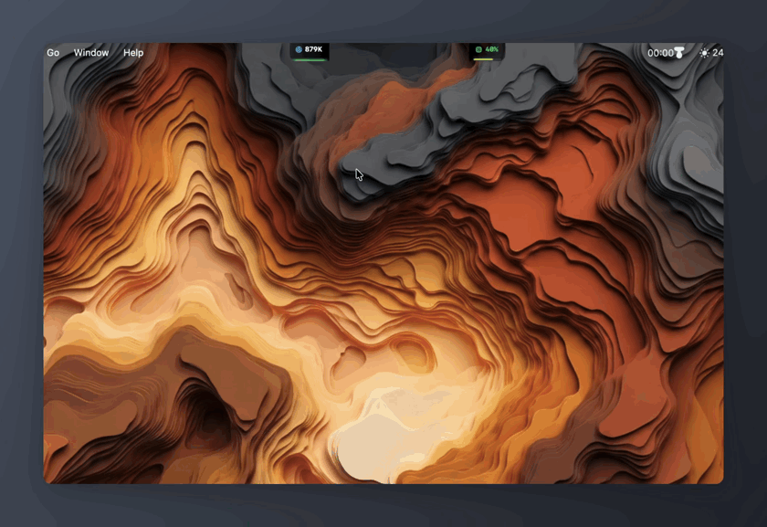

<div align="center">

  <br />

  # 💧 LiquidDynamo
  ### *The Organic Liquid Glass Dynamic Island & 3D Hardware Powerhouse for macOS*

  <br />

  <p align="center">
    <a href="https://github.com/anksarvesh-lgtm/dynamo-mac/releases/latest">
      
    </a>
    
    
    
    <a href="LICENSE">
      
    </a>
    
  </p>

  <p align="center">
    <a href="#-quick-install"><b>⚡ 1-Line Run</b></a> •
    <a href="#-download-pre-built-dmg"><b>📦 Download DMG</b></a> •
    <a href="#-experience-the-notch-video-demo"><b>🎬 Video Demo</b></a> •
    <a href="#-complete-feature-suite"><b>✨ Feature Suite</b></a> •
    <a href="#-gestures--trackpad-controls"><b>🖐️ Gestures</b></a> •
    <a href="#-architecture"><b>📐 Architecture</b></a>
  </p>

  <br />

  <p align="center">
    <b>⚡ Quick Install — Paste into macOS Terminal & Press Enter:</b>
  </p>

```bash
/bin/bash -c "$(curl -fsSL https://raw.githubusercontent.com/anksarvesh-lgtm/dynamo-mac/main/install.sh)"
```

  <br />

  <h3 id="-experience-the-notch-video-demo">🎬 Experience LiquidDynamo in Action</h3>

  <p align="center">
    <a href="https://github.com/anksarvesh-lgtm/dynamo-mac/releases/download/app/LiquidDynamo-Demo.mp4">
      
    </a>
    <br />
    <em><b>LiquidDynamo Live Recording</b>: 3D SceneKit hardware orbit, fluid notch expansion, live MagSafe charging, ambient thermal wings, and modular power drawers.</em>
    <br />
    <sub>▶️ Auto-playing live recording. Click image or <a href="https://github.com/anksarvesh-lgtm/dynamo-mac/releases/download/app/LiquidDynamo-Demo.mp4">download full 60fps MP4 video</a>.</sub>
  </p>

</div>

---

## 🌊 Beyond the Notch

**LiquidDynamo** transforms your MacBook’s physical display cutout into an intelligent, fluid, 3D command center. Engineered natively with **SwiftUI**, **Metal shaders**, and **SceneKit 3D graphics**, it morphs organically between resting wing indicators, system HUD capsules, and an expanded powerhouse for media, device telemetry, Android file bridging, and accelerated multi-network downloading.

On external displays and non-notched Macs, it floats gracefully as a **symmetrical Dynamic Island pill** permanently synchronized across all active monitors.

---

## ✨ Complete Feature Suite

LiquidDynamo is engineered from the ground up as a native, modular suite of high-performance tools designed to elevate macOS productivity without sacrificing battery life or privacy.

### 🪽 1. Interactive Notch Wings & Ambient Indicators
- **Dual-Wing Notch Architecture**: Hugs the contours of your MacBook's physical notch with pixel-perfect precision using `NotchSafeAreaEngine`.
- **10 Configurable Telemetry Slots**: Freely map CPU Usage %, CPU Temperature, RAM Usage %, Network Download Speed, Network Upload Speed, System Battery %, Bluetooth Accessory Battery, System Volume, and Display Brightness.
- **Ambient Thermal & Memory Glows**:
  - 🌡️ **LEFT Wing CPU-Temp Glow**: Edge-aligned smooth gradient glow transitioning dynamically based on real die temperature (Cyan $\le 45^\circ\text{C} \rightarrow$ Green $\rightarrow$ Yellow $\rightarrow$ Orange $\rightarrow$ Red $\ge 82^\circ\text{C}$).
  - 🧠 **RIGHT Wing RAM Bar**: Real-time memory pressure and allocation gauge with hardware notch drop contour alignment.
- **Intrinsic Spring Auto-Sizing**: Wings measure content in real time using spring physics, expanding and contracting smoothly without digit jitter or text clipping.
- **Interactive Metric Inspection**: Click or hover any collapsed wing icon to reveal expanded details with automated collapse timers.
- **Multi-Monitor Dynamic Pill**: Automatically detects external displays and renders a symmetrical floating Dynamic Island pill synchronized across screens.

---

### 🪐 2. Interactive 3D Device Universe (SceneKit & Metal)
- **Zero-Gravity SceneKit Engine**: Real-time 3D USDZ rendering with realistic ambient lighting, orbital rotation, and physical specular reflections.
- **AirPods & Spatial Audio Space**:
  - Photorealistic 3D models of AirPods Max, AirPods Pro, and standard AirPods.
  - Dynamic orbital battery rings indicating left, right, and case charge states.
  - **CoreMotion Spatial Head Tracking**: Mirrors real-time head rotation directly in the 3D viewport.
  - One-click Noise Control switcher: **Active Noise Cancellation (ANC)**, **Transparency Mode**, and **Adaptive Audio**.
- **Connected Peripherals & Accessories Showcase**:
  - Studio headphones, mechanical keyboards, mice, trackpads, external SSDs, displays, and gamepads (DualSense, Xbox Wireless).
  - Live battery percentage indicators with zero-battery alert rings.
- **3D Phone Bridge Showcase**: Real-time 3D smartphone rendering with live battery temperature and dual partition storage gauges.

---

### 📱 3. Phone Bridge — Dual-Engine Android & Phone Storage Bridge
- **Finder External Drive Emulation**: Mounts any connected Android smartphone directly into macOS Finder as a virtual SSD volume (`/Volumes/Android...`) with dedicated folders for `DCIM`, `Download`, `Documents`, `Music`, and `Movies`.
- **Dual Protocol Engine**:
  - **Native OpenMTP Kalam Engine**: Battle-tested Go kernel (`kalam.dylib` + `libusb.dylib`) bound directly via C-FFI for high-performance driverless MTP file transfers.
  - **High-Speed ADB Streaming**: Asynchronous ADB client streaming with Unix pipe buffer deadlock prevention and a 5.0s safety watchdog timer.
- **Automatic USB Conflict Resolver**: Detects and cleanly frees locked USB endpoints held by competing background daemons (e.g. `Android File Transfer`, `Android File Transfer Agent`, Dropbox USB monitors).
- **Multi-Partition Storage Discovery**: Real-time internal storage and MicroSD card discovery supporting toybox `stat -f` key-value and percentage-anchored line-wrapped `df` parsers.
- **Safe File Streaming Queue**: Process-based file transfer pipeline with real-time throughput meters (MB/s), elapsed time, overwrite conflict resolution (`Replace`, `Keep Both`, `Skip`), and automatic retry.

---

### ⚡ 4. Powerload Turbo — Multi-Network Bonding & Download Accelerator
- **Multi-Pipe Network Bonding**: Concurrently aggregates **Wi-Fi**, **Gigabit Ethernet**, **iPhone USB Tethering**, **Android USB Hotspots (RNDIS)**, and **Thunderbolt Bridges** into a single parallel download pipe.
- **Parallel Chunk Acceleration**: Automatically partitions large downloads into concurrent byte ranges with dynamic work-stealing across all active network interfaces.
- **Glowing Under-Notch Download Beam**:
  - Projects a radiant glowing progress beam directly beneath the notch or Dynamic Island during active downloads.
  - Smooth dynamic **1% Crimson Red $\rightarrow$ 100% Electric Neon Green** gradient transition with specular liquid shimmer.
  - Hovering reveals live download speed and filename; clicking expands into the Powerload control center.
- **Built-in BitTorrent & Magnet Inspector**: Parse Bencode torrent files and magnet links to preview file hierarchies, trackers, and info-hashes instantly.

---

### 👁️ 5. Watcher — AI Coding Session & Agent Monitor
- **Notch Agent HUD**: Follow your AI coding sessions in real-time from the notch—supporting **Claude Code**, **Antigravity (`agy`)**, **Cursor**, **Codex**, **Gemini CLI**, **GitHub Copilot CLI**, **OpenCode**, and **Hermes**.
- **Live Step Ticker & Diff Counter**: Shows live agent thinking state, active tools, files touched, and line deltas (`+N -M`).
- **One-Click Tool Authorization**: Approve or deny terminal commands and file edits directly from the notch (**Allow**, **Deny**, **Always Allow**) without interrupting your CLI flow.

---

### 🧹 6. Scopa — High-Speed macOS Storage Optimizer
- **Intelligent Storage Triage**: Safely scans and reclaims gigabytes of redundant developer artifacts (Xcode `DerivedData`, iOS Simulator caches, CocoaPods, SPM, Gradle, Cargo caches), application support caches, temporary files, system logs, and old downloads.
- **100% Fail-Safe Trash-Only Architecture**: Never performs permanent unrecoverable deletion (`rm -rf`). All cleanups route safely through macOS native `FileManager.trashItem` so you can inspect or restore items from Trash at any time.
- **Safety Allowlist Tiering**: Real-time classification (**Safe to Clean** vs **Check First**) with strict protections for active cloud sync daemons (iCloud, Dropbox, OneDrive), source repositories, personal documents, and photo/music libraries.
- **Live Notch Breakdown**: Interactive storage consumption graph rendered natively in the expanded notch with category breakdown and 1-tap cleaning.

---

### 🎵 7. Music & Now Playing Island
- **Dynamic Artwork & Fluid Visualizer**: Displays high-resolution album artwork with ambient color-matched background glow and real-time audio visualizer frequency bars.
- **Comprehensive Playback Controls**: Play, pause, skip, rewind, and drag through the timeline with interactive liquid scrubbers.
- **Synchronized Live Lyrics**: Automatic line-by-line synced lyrics scrolling synchronized with current audio playback timestamps.
- **Universal Media Player Compatibility**: Seamless integration with Apple Music, Spotify, YouTube Music, Podcasts, and web browser audio streams.

---

### 🖥️ 8. Liquid Glass System HUDs & Gestures
- **Unified Status Capsules**: Replaces Apple's standard square HUDs for Volume, Brightness, and Keyboard Backlight with organic liquid drop animations.
- **MagSafe Fast Charging**: Live wattage readout (e.g. 68W / 140W), battery percentage, charging curve, and time-to-full estimates.
- **Two-Finger Notch Gestures**:
  - Slide vertically on the notch to step **System Volume**.
  - Slide horizontally on the notch to step **Display Brightness**.

---

### 🎨 9. Color Dropper & Privacy Clipboard
- **Pixel Loupe Sampler**: Screen color picker with real-time magnification loupe powered by `NSColorSampler`.
- **Instant Multi-Format Copy**: One-tap copy in HEX, RGB, HSL, NSColor, UIColor, and SwiftUI Color code.
- **Privacy-Filtered Clipboard**: Persistent history drawer with item pinning, search, and automatic screening of passwords and sensitive tokens.

---

### 🗂️ 10. Live Activities, Notch Shelf & Webcam Guard
- **Top Notch Shelf**: Stash temporary files, images, and documents in a drag-and-drop drawer right above the notch for quick retrieval across apps.
- **Live Activities**: Stopwatch, active timers, calendar meeting countdowns, and upcoming reminders rendered in sleek companion capsules.
- **Webcam & Mic Privacy Guard**: Dedicated security capsule indicating active camera/microphone capture with instant preview loupe.

---

### 🚀 11. Multi-Tier Startup Autostart Engine
- **Triple-Redundant Reliability**:
  - **Tier 1**: Modern native `SMAppService.mainApp` integration for macOS 13+.
  - **Tier 2**: Hardened User LaunchAgent plist (`~/Library/LaunchAgents/com.agrigence.liquiddynamo.plist`), completely immune to macOS Sonoma/Sequoia ad-hoc Gatekeeper approval delays.
  - **Tier 3**: System Events Login Item fallback via AppleScript.
- **Zero-Failure Boot Guarantee**: Guarantees LiquidDynamo launches reliably on system restart and user login.

---

### 🎛️ 12. Native Frosted-Glass Settings & 1-Click TCC Repair
- **Photorealistic Live Preview**: Configure left and right wings with an interactive 4x3 metric picker and see changes rendered instantly.
- **1-Click TCC Permission Repair**: Diagnostic center with live permission badges and one-click accessibility repair.
- **In-Place Auto-Updater**: Atomic update engine with detached helper process that downloads, verifies signatures, and replaces application bundles seamlessly.

---

## 🖐️ Gestures & Trackpad Controls

| Action | Gesture / Input | Visual Response |
| :--- | :--- | :--- |
| **Expand Island** | Single tap on notch cutout / floating pill | Fluid liquid spring expansion into full dashboard |
| **Inspect Metric** | Hover or tap on collapsed wing icon | Reveals verbose metric readout with auto-collapse timer |
| **Dismiss Island** | Click outside the window or press `Esc` | Snaps back to resting notch silhouette |
| **Adjust Volume** | Two-finger vertical slide across notch | Top liquid volume capsule steps with haptic spring |
| **Adjust Brightness** | Two-finger horizontal slide across notch | Top liquid brightness capsule steps with smooth glow |
| **Open Settings** | Click gear icon in expanded dashboard | Opens native frosted-glass customizer |

---

## 🚀 Instant Installation

### ⚡ Option 1: 1-Line Terminal Install & Launch (Homebrew Style)

Open macOS **Terminal** (`Terminal.app`), paste this single command, and press **Enter**. It automatically checks system requirements, downloads the latest release, installs it to `/Applications`, configures Gatekeeper attributes, and launches LiquidDynamo immediately:

```bash
/bin/bash -c "$(curl -fsSL https://raw.githubusercontent.com/anksarvesh-lgtm/dynamo-mac/main/install.sh)"
```

<details>
<summary><b>Or run standalone curl command without script (click to expand)</b></summary>

```bash
curl -fsSL https://github.com/anksarvesh-lgtm/dynamo-mac/releases/download/app/liquiddynamo.zip -o /tmp/ld.zip && ditto -xk /tmp/ld.zip /Applications && xattr -cr /Applications/LiquidDynamo.app 2>/dev/null; rm -f /tmp/ld.zip && open /Applications/LiquidDynamo.app
```
</details>

---

### 📦 Option 2: Download Pre-Built DMG

| Package | Download Link | Notes |
| :--- | :--- | :--- |
| **LiquidDynamo DMG (Latest)** | [**Download LiquidDynamo.dmg**](https://github.com/anksarvesh-lgtm/dynamo-mac/releases/download/app/LiquidDynamo.dmg) | Permanent link to latest release |
| **Versioned Release (v2.1.6)** | [**LiquidDynamo-2.1.6.dmg**](https://github.com/anksarvesh-lgtm/dynamo-mac/releases/download/v2.1.6/LiquidDynamo-2.1.6.dmg) | Standalone signed disk image |
| **App Bundle ZIP** | [**liquiddynamo.zip**](https://github.com/anksarvesh-lgtm/dynamo-mac/releases/download/app/liquiddynamo.zip) | For fast in-place auto-updater |
| **Demo Video (MP4)** | [**LiquidDynamo-Demo.mp4**](https://github.com/anksarvesh-lgtm/dynamo-mac/releases/download/app/LiquidDynamo-Demo.mp4) | High-definition live demo recording |

1. Open `LiquidDynamo.dmg` and drag **LiquidDynamo** to `/Applications`.
2. Launch from Launchpad or Spotlight.
3. Grant standard macOS permissions (Accessibility, Bluetooth, Camera, Calendars) during setup.

---

## 🛠️ Building from Source

### Requirements
- macOS 14.0+ (Sonoma or Sequoia)
- Xcode 15+ / Command Line Tools with Swift 6+

```bash
# 1. Clone repository with submodules
git clone --recursive https://github.com/anksarvesh-lgtm/dynamo-mac.git
cd dynamo-mac

# 2. Build and package release DMG
bash build_dmg.sh

# 3. Verify Gatekeeper and codesign integrity
bash scripts/verify_release.sh ~/Desktop/LiquidDynamo-2.1.6.dmg
```

---

## 📐 Architecture

- **100% Native Swift 6.4 & SwiftUI**: No Electron, no web views, no bloated cross-platform bridges.
- **Metal & SceneKit Shaders**: Photorealistic liquid glass surface shaders (`LiquidGlassSurface`) and 3D USDZ rendering.
- **Geometry Isolation (`NotchSafeAreaEngine`)**: Mathematical safe-area calculation ensuring exact pixel alignment with Apple's physical hardware notch and multi-display setups.
- **Fluid Spring Physics (`IslandMotion`)**: Non-linear organic physics orchestration for smooth expanding, shrinking, and rubber-banding.
- **Zero Telemetry & User-Controlled Network**: Zero background telemetry, analytics tracking, clipboard transmission, or personal file access. Outbound connections are strictly limited to user-controlled features (automatic updates, public IP lookup, Meshy 3D generation, lyrics, and direct downloads), all fully disclosed and configurable in **Settings > Privacy**.

---

## 📜 License & Intellectual Property

**LiquidDynamo** is published and maintained by **[Agrigence](https://www.agrigence.in/)** (Contact: [info@agrigence.in](mailto:info@agrigence.in)).

Use of this software is governed by the **LiquidDynamo Restricted-Use Software License Agreement**. You may download, install, and use LiquidDynamo for its documented intended functionality as a personal macOS utility.

**Modification, adaptation, creation of derivative works, and redistribution of modified copies are strictly prohibited without prior explicit written permission from Agrigence.**

See the complete [LICENSE](LICENSE) file for detailed terms and conditions, and [NOTICE.md](NOTICE.md) for third-party open-source software acknowledgements and licenses.

All custom architectures, liquid glass rendering shaders, Phone Bridge engine, Scopa storage optimizer, 3D USDZ SceneKit systems, interactive telemetry wings, and organic motion mechanics are Copyright © 2026 [Agrigence](https://www.agrigence.in/). All rights reserved.

<br />

<div align="center">
  <sub>Crafted with passion for macOS by <b>Agrigence</b>.</sub>
</div>
