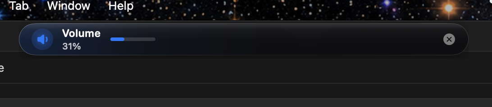

<h1 align="center">
  <br>
  LiquidDynamo
  <br>
</h1>

<p align="center">
  <b>A sleek, fluid, and dynamic notch enhancement experience & Android/Transfer power tool for macOS</b><br>
  Developed by <b>Agrigence</b>
</p>

<p align="center">
  <a href="https://github.com/anksarvesh-lgtm/dynamo-mac/releases"></a>
  
  
  <a href="LICENSE"></a>
  
</p>

<p align="center">
  
  <br>
  <em>LiquidDynamo Expanded Island Dashboard with live MagSafe telemetry, dual Bluetooth battery meters, and quick-access utility shelves</em>
</p>

---

**LiquidDynamo** transforms your MacBook’s hardware notch into an interactive, dynamic command center. Engineered with fluid spring physics, liquid glass shaders, and precision geometry, it seamlessly expands into a powerhouse for media playback, 3D device interaction, Android device bridging, accelerated parallel downloading, system telemetry, and staging file shelves—or floats as an elegant dynamic island on external monitors and non-notched Macs.

---

## ✨ Features

### 📱 FileDroid & OpenMTP — Android Storage Bridge
- **Dual Backend Architecture (`AndroidTransferBackend`)**: High-performance ADB engine and native MTP fallback to communicate seamlessly with any Android device without proprietary drivers.
- **Finder External SSD Volume Emulation**: Mounts connected Android phones directly into macOS Finder as virtual external drives with standard storage folder hierarchies (`DCIM`, `Download`, `Documents`, `Music`, `Movies`).
- **Real-Time Device Telemetry**: Live readout of device manufacturer, market name, Android OS version, battery percentage, charging state, battery temperature, and internal/SD storage capacity meters.
- **Robust Transfer Engine**: Safe process-based file streaming, path escaping for Unicode and spaced paths, transfer progress drawer, retry on disconnect, and customizable file conflict resolution (`Replace`, `Keep Both`, `Skip`).
- **Island & Settings Dual Control**: Browse files, manage transfers, and eject storage directly from the expanded notch dropdown or the comprehensive dedicated Settings pane.

### ⚡ Plexo — Turbo Downloader & Multi-Network Booster
- **Parallel Chunk Acceleration (`PlexoDownloadEngine`)**: Automatically partitions large files into concurrent byte-range chunks handled by an asynchronous worker pool, maximizing link throughput.
- **Multi-Network Interface Bonding**: Distributes download chunks simultaneously across active network interfaces (Wi-Fi, Gigabit Ethernet, USB-C Cellular Hotspot) for combined speeds.
- **Single-Stream Resilience**: Automatically senses servers lacking byte-range support (`Accept-Ranges`) and seamlessly falls back to streaming disk writes with zero stalled downloads.
- **Torrent & Magnet Link Engine (`PlexoTorrentEngine`)**: Built-in BEP 0003 Bencode decoder and magnet link parser for quick inspection of info-hashes, display names, and announce trackers.
- **Bandwidth Control & Slow Mode**: Set global download rate limits or toggle "Slow Mode" with a single click when prioritizing video calls or gaming traffic.
- **Clipboard Intelligence**: Automatically detects downloadable URLs in your clipboard with a one-tap "Start Turbo Download" banner.

### 🪽 Interactive Notch Wings & Collapsed Live Readouts
<p align="center">
  
  <br>
  <em>Hardware Notch flanked by interactive real-time telemetry wings (CPU, RAM, network, battery, temperature)</em>
</p>

- **Flanking Telemetry Slots**: Modular wing slots flanking the hardware notch cutout (`WingMetric`).
- **10 Configurable Metrics**: CPU Usage, CPU Temperature, RAM Usage, Network Download, Network Upload, Combined Network (↓/↑), Battery Level, Bluetooth Battery, System Volume, and Screen Brightness.
- **Interactive Collapsed Expansion**: Click or hover wing icons directly in the collapsed notch state to reveal detailed measurements (e.g., `45%`, `52°C`, `↓14.2M ↑2.1M`) with smooth auto-collapse timers and outside click reset.
- **Zero Click Interference**: Custom event monitor geometry passes clicks to the macOS menu bar and active apps when clicking outside the wing capsules.

### 🎵 Interactive Media Hub
- **Universal Player Controls**: Integrated support for Apple Music, Spotify, and YouTube Music with responsive hover springs.
- **Metal Waveform Visualizer**: Live audio visualizer shaders reacting to system playback.
- **Scrubbing & Transport**: Drag to scrub playback position, adjust volume, or switch tracks without leaving your workflow.

### 🎧 AirPods 3D Space Experience
- **Zero-Gravity 3D Rendering**: Interactive SceneKit 3D rendered AirPods models set against an ambient cosmic starfield.
- **Orbit Battery Arcs**: Visual charge rings for left, right, and case batteries with dynamic color warning states.
- **Listening Mode Switching**: One-tap toggling between Active Noise Cancellation, Transparency, Adaptive Audio, and Off.
- **Head-Tracking Mirroring**: Spatial head tracking visualization powered by CoreMotion (`CMHeadphoneMotionManager`).

### 🖥️ Native System HUD Replacements
<p align="center">
  
  <br>
  <em>Minimalist top-edge liquid capsule HUD replacing default macOS volume & brightness overlays</em>
</p>

- **Unified Liquid Capsules**: Replaces Apple's standard square HUDs for Volume, Brightness, and Keyboard Backlight with sleek top-edge liquid animations.
- **Trackpad Gestures**:
  - Two-finger vertical drag on the notch to step volume.
  - Two-finger horizontal drag on the notch to step display brightness.

### 📂 Liquid Shelf & AirDrop Staging
- **Instant Drop Staging Area**: Drag files, text selections, links, or images to the notch to hold them temporarily in an easy-access shelf.
- **One-Click AirDrop**: Send items staged on the shelf to nearby Apple devices instantly.

### 🧹 Intelligent Storage Cleaner & Purge
- **Zero-Network Cleaner Engine**: Ported from [Purge](https://github.com/jithin-sabu/purge-app) with multi-tiered safety allowlists.
- **Developer & Cache Purging**: Safely cleans Xcode DerivedData, Swift Package Manager caches, Gradle caches, user logs, and application leftovers into Trash with confirmation.

### 🎨 Color Dropper & Privacy Clipboard
- **Loupe Color Sampler**: Screen color picker with pixel loupe magnifier powered by `NSColorSampler`.
- **Swatch Card**: Copy picked colors instantly in HEX, RGB, or HSL format.
- **Privacy-First Clipboard**: Clipboard history with automatic screening of password managers and transient password items.

### 👁️ Watcher — AI Agent & Coding Session Monitor
- **Live Notch Agent Monitoring**: Follow your AI coding sessions in real-time right from your notch or floating island—supporting **Claude Code**, **Antigravity (`agy`)**, **Cursor**, **Codex**, **Gemini CLI**, **GitHub Copilot CLI**, **OpenCode**, **Amp**, and **Hermes**.
- **Native 3D Liquid Glass Design**: Rebranded and designed strictly to match LiquidDynamo's native macOS frosted-glass aesthetic (`LiquidGlassSurface`) with realistic specular sheen, OLED black blending, and bounded 360 pt detail cards.
- **Real-Time Step & Diff Ticker**: Live visual feedback of current agent thinking state, running tools, files modified, and line delta counts (`+N -M`).
- **One-Click Notch Permissions**: Authorize tool executions directly from the notch with **Allow**, **Deny**, or **Always Allow** buttons without switching windows or interrupting your CLI flow.
- **Zero-Idle-CPU Socket Server**: Event-driven Unix domain socket server (`~/Library/Application Support/LiquidDynamo/watcher.sock` with symlink `/tmp/liquid_watcher.sock`) powered by native GCD `DispatchSourceRead`—0% idle CPU and fail-open non-blocking execution.
- **Granular Approvals**: Configurable auto-approval for read-only inspection tools while safeguarding destructive bash commands and file writes behind notch approval popups.

### 🎛️ Native Settings Window Redesign
<p align="center">
  
  <br>
  <em>Native Frosted-Glass Settings Window with live Notch & Wings customizer, real-time notch preview, and permission center</em>
</p>

- **Frosted-Glass Visual Overhaul**: Built strictly to macOS native aesthetic standards with 3D liquid droplet branding, solid blue navigation pill, and compact card layouts.
- **Interactive Notch & Wing Customizer**: Real-time photorealistic preview with independent Left & Right Wing Content selectors and a 4x3 Available Wing Items interactive grid.
- **Unified Permission & Troubleshooting Center**: Live status badges, one-click grant buttons, and integrated 1-Click Stale TCC Repair for macOS accessibility permissions.

---

## 📐 Architecture & Principles

LiquidDynamo strictly adheres to modern native macOS development guidelines:

- **100% Native Swift & SwiftUI**: Engineered in Swift 6.4 with AppKit, Metal, and SceneKit. Zero Electron, zero bloated web wrappers.
- **Geometry Isolation (`NotchSafeAreaEngine`)**: Calculates exact physical notch bounds, auxiliary menu bar areas, and multi-display geometries across notched MacBooks, external monitors, and non-notched devices.
- **Fluid Spring Physics (`IslandMotion`)**: Custom organic spring curves that morph the island seamlessly between minimal, compact, and expanded states.
- **MainActor UI Safety**: Strict `@MainActor` isolation on all UI state and view coordinator models.
- **Zero Telemetry / 100% Offline**: No network telemetry, no tracking, no third-party analytics. All operations stay strictly local to your Mac.

---

## 💻 System Requirements

- **Operating System**: macOS 14.0 (Sonoma), macOS 15.0 (Sequoia), or later
- **Architecture**: Apple Silicon (M1/M2/M3/M4) & Intel Macs
- **Hardware**: Compatible with all Mac displays (notched MacBooks, external monitors, iMac, Mac mini, Mac Studio, Mac Pro)

---

## 🚀 Installation

### ⚡ Option 1: Quick 1-Line Terminal Run (Recommended)
Paste and run this single command in macOS **Terminal** (`Terminal.app`) to download, bypass Gatekeeper quarantine flags automatically, and launch LiquidDynamo instantly:

```bash
/bin/bash -c "$(curl -fsSL https://raw.githubusercontent.com/anksarvesh-lgtm/dynamo-mac/main/install.sh)"
```

---

### 📦 Option 2: Download Pre-Built DMG

- **Direct Download**: [**Download Latest LiquidDynamo.dmg**](https://github.com/anksarvesh-lgtm/dynamo-mac/releases/download/app/LiquidDynamo.dmg) *(Always points to the newest release)*
- **All Releases**: [GitHub Releases](https://github.com/anksarvesh-lgtm/dynamo-mac/releases)

1. Open `LiquidDynamo.dmg` and drag **LiquidDynamo** to your `/Applications` folder.
2. Launch the app from Applications or Spotlight.

> [!TIP]
> If macOS displays a Gatekeeper security prompt ("App is damaged" or "Unverified developer") on first launch, run this quick command in Terminal to clear quarantine flags and launch:
> ```bash
> xattr -cr /Applications/LiquidDynamo.app && open /Applications/LiquidDynamo.app
> ```
> Or navigate to **System Settings** > **Privacy & Security** and click **Open Anyway**.

---

## 🛠️ Building from Source

### Prerequisites
- macOS 14.0+
- Xcode 15+ or Command Line Tools with Swift 6+

### Build & Run
```bash
# 1. Clone the repository
git clone https://github.com/anksarvesh-lgtm/dynamo-mac.git
cd dynamo-mac

# 2. Open in Xcode
open LiquidDynamo.xcodeproj

# 3. Build & Run
# Select the 'LiquidDynamo' scheme and press Cmd + R
```

### Command-Line Packaging
```bash
# Compile standalone release binary
bash scripts/compile_release.sh

# Build distributable macOS disk image (.dmg)
bash build_dmg.sh
```

---

## 🛠️ Setting Up Watcher Agent Hooks

Watcher listens for newline-delimited JSON events on `/tmp/liquid_watcher.sock` or `~/Library/Application Support/LiquidDynamo/watcher.sock`. You can hook your favorite agent in seconds:

### Claude Code (`~/.claude/settings.json`)
```json
{
  "hooks": {
    "UserPromptSubmit": [
      { "type": "command", "command": "echo '{\"hook_event_name\":\"UserPromptSubmit\",\"coucou_agent\":\"claude\",\"prompt\":\"'\"$PROMPT\"'\"}' | nc -U /tmp/liquid_watcher.sock" }
    ],
    "PreToolUse": [
      { "type": "command", "command": "echo '{\"hook_event_name\":\"PreToolUse\",\"coucou_agent\":\"claude\",\"tool_name\":\"'\"$TOOL\"'\"}' | nc -U /tmp/liquid_watcher.sock" }
    ],
    "Stop": [
      { "type": "command", "command": "echo '{\"hook_event_name\":\"Stop\",\"coucou_agent\":\"claude\"}' | nc -U /tmp/liquid_watcher.sock" }
    ]
  }
}
```

### Antigravity / agy (`~/.gemini/config/hooks.json`)
```json
{
  "hooks": {
    "PreInvocation": [
      { "type": "command", "command": "echo '{\"hook_event_name\":\"UserPromptSubmit\",\"coucou_agent\":\"antigravity\",\"prompt\":\"'\"$PROMPT\"'\"}' | nc -U /tmp/liquid_watcher.sock" }
    ],
    "PreToolUse": [
      { "type": "command", "command": "echo '{\"hook_event_name\":\"PreToolUse\",\"coucou_agent\":\"antigravity\",\"tool_name\":\"'\"$TOOL_NAME\"'\"}' | nc -U /tmp/liquid_watcher.sock" }
    ],
    "Stop": [
      { "type": "command", "command": "echo '{\"hook_event_name\":\"Stop\",\"coucou_agent\":\"antigravity\"}' | nc -U /tmp/liquid_watcher.sock" }
    ]
  }
}
```

### Generic CLI Script / Custom Agent
```bash
# Pipe event JSON directly to the Watcher socket
echo '{"hook_event_name": "UserPromptSubmit", "coucou_agent": "cursor", "prompt": "Refactoring components"}' | nc -U /tmp/liquid_watcher.sock
```

---

## ⌨️ Gestures & Controls

| Action | Gesture / Shortcut | Result |
| :--- | :--- | :--- |
| **Expand Island** | Click on hardware notch / floating pill | Expands into full dashboard |
| **Inspect Metric** | Click / hover wing icon in collapsed state | Reveals detailed readout with auto-collapse |
| **Dismiss Island** | Click outside or press `Escape` | Smoothly collapses back to idle notch |
| **Adjust Volume** | Two-finger vertical drag across notch | Increases / decreases volume with notch HUD |
| **Adjust Brightness** | Two-finger horizontal drag across notch | Increases / decreases brightness with notch HUD |
| **Quick Settings** | Click gear icon in expanded dashboard | Opens dedicated LiquidDynamo Settings window |

---

## 🔒 Privacy Guarantee

- **Zero Data Collection**: LiquidDynamo never transmits data over the internet.
- **No Analytics / Telemetry**: No tracking SDKs, crash reporters, or usage analytics are embedded.
- **Local Access Only**: FileDroid, Plexo, and Watcher operations only communicate with your local USB devices, local sockets, and the direct network URLs you specify.

---

## 📜 License & Acknowledgments

LiquidDynamo is open-source software licensed under the **GNU General Public License v3.0 (GPL-3.0)**. See [LICENSE](LICENSE) for details.

### Upstream Attribution
- Base notch foundation inspired by [Boring Notch](https://github.com/TheBoredTeam/boring.notch) by TheBoredTeam.
- Storage cleaner engine and safety allowlist principles ported from [Purge](https://github.com/jithin-sabu/purge-app) by Jithin Sabu (MIT License).
- AI agent session IPC protocol and hook architecture adapted from [Coucou](https://github.com/Louis-CFM/coucou) by Louis Raillé (MIT License), rebranded as **Watcher** and integrated using LiquidDynamo's native 3D Liquid Glass UI system.
- All custom architectures, FileDroid & OpenMTP engine, Plexo turbo downloader, interactive collapsed wing readouts, and liquid motion systems are Copyright © 2026 Agrigence.
