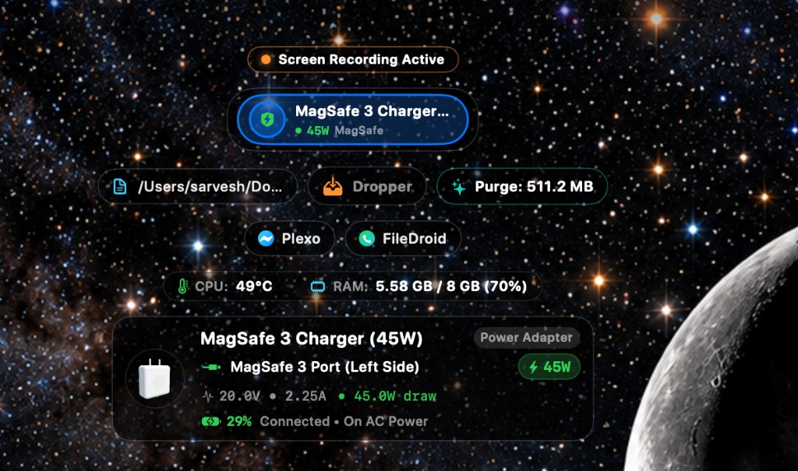
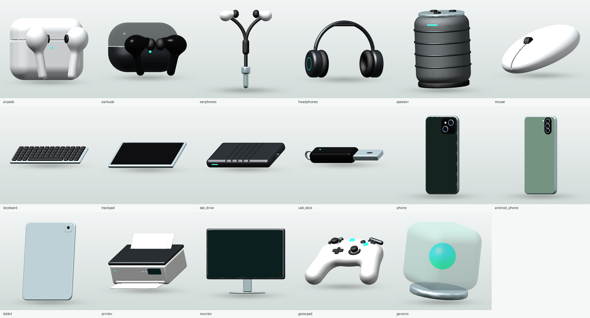
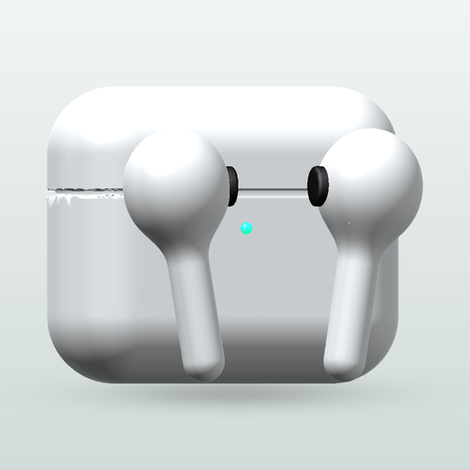
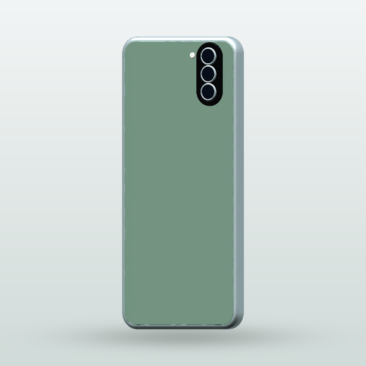
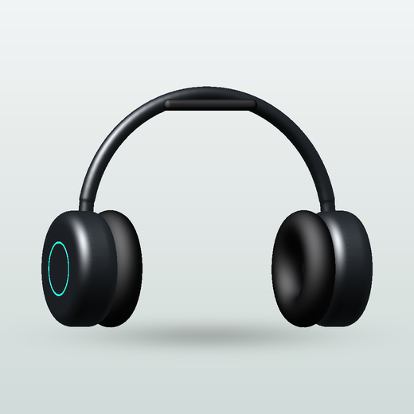
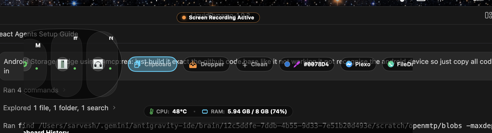
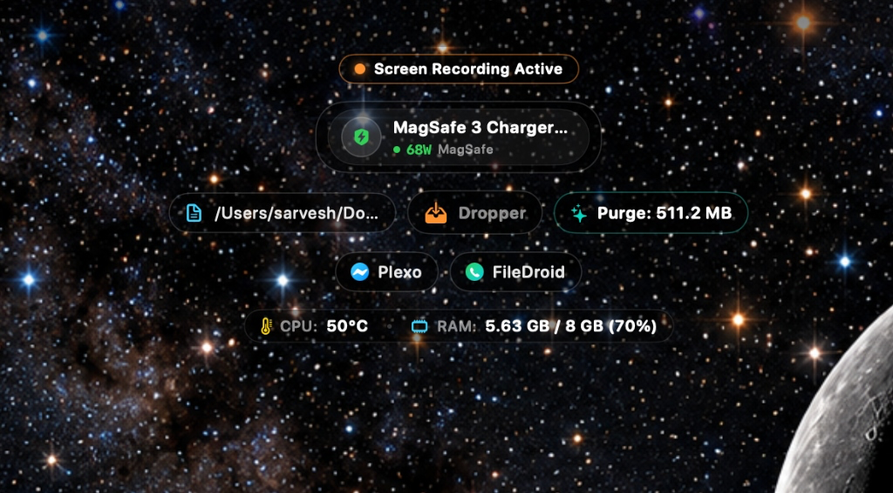
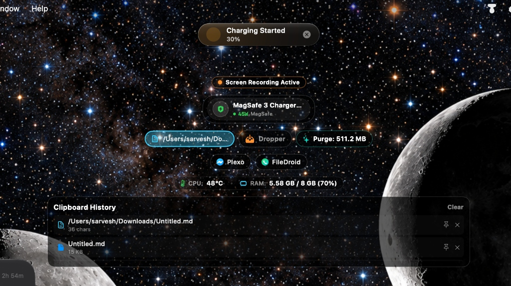
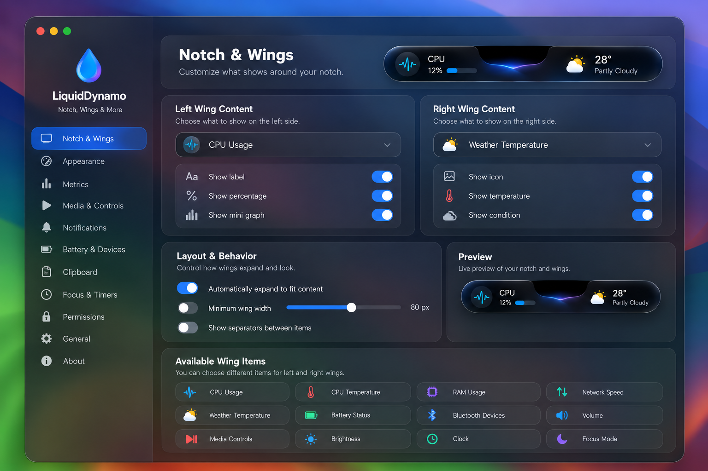

<div align="center">

  <br />

  # 💧 LiquidDynamo
  ### *The Organic Liquid Glass Dynamic Island & 3D Hardware Powerhouse for macOS*

  <br />

  <p align="center">
    <a href="https://github.com/anksarvesh-lgtm/dynamo-mac/releases/latest">
      
    </a>
    
    
    
    <a href="LICENSE">
      
    </a>
    
  </p>

  <p align="center">
    <a href="#-instant-installation"><b>⚡ 1-Line Run</b></a> •
    <a href="#-download-pre-built-dmg"><b>📦 Download DMG</b></a> •
    <a href="#-interactive-3d-device-universe"><b>🪐 3D Device Universe</b></a> •
    <a href="#-features-at-a-glance"><b>✨ Key Features</b></a> •
    <a href="#-gestures--trackpad-controls"><b>🖐️ Gestures</b></a> •
    <a href="#-architecture"><b>📐 Architecture</b></a>
  </p>

  <br />

  <p align="center">
    <b>⚡ Quick Install — Paste into macOS Terminal & Press Enter:</b>
  </p>

```bash
/bin/bash -c "$(curl -fsSL https://raw.githubusercontent.com/anksarvesh-lgtm/dynamo-mac/main/install.sh)"
```

  <br />

  <p align="center">
    
    <br />
    <em>LiquidDynamo Expanded Island: 3D hardware telemetry, live MagSafe charging, ambient thermal wings, and modular utility drawers</em>
  </p>

</div>

---

## 🌊 Beyond the Notch

**LiquidDynamo** transforms your MacBook’s physical display cutout into an intelligent, fluid, 3D command center. Engineered natively with **SwiftUI**, **Metal shaders**, and **SceneKit 3D graphics**, it morphs organically between resting wing indicators, system HUD capsules, and an expanded powerhouse for media, device telemetry, Android file bridging, and accelerated multi-network downloading.

On external displays and non-notched Macs, it floats gracefully as a **symmetrical Dynamic Island pill** permanently synchronized across all active monitors.

---

## 🪐 Interactive 3D Device Universe

LiquidDynamo features a native **SceneKit zero-gravity 3D rendering engine** that breathes life into connected accessories with realistic depth, lighting reflections, and orbital motion.

<div align="center">
  
  <br />
  <em>Native USDZ 3D models rendered in real-time with ambient lighting, orbital rotation, and dynamic battery charge rings</em>
</div>

<br />

| 🎧 AirPods & Spatial Audio | 📱 Android & Storage Drives | 🎮 Peripherals & Accessories |
| :---: | :---: | :---: |
| <br />**SceneKit 3D AirPods Space**<br />• Dynamic orbital battery rings<br />• CoreMotion spatial head tracking<br />• ANC, Transparency & Adaptive toggle | <br />**Phone Bridge 3D Showcase**<br />• Finder external volume emulation<br />• Live battery temperature & storage<br />• Dual ADB + MTP streaming engine | <br />**Dynamic Device Showcase**<br />• Studio headphones, keyboards, mice<br />• Gamepads, SSDs, external displays<br />• Zero-battery warning indicators |

---

## ✨ Features at a Glance

### 🪽 Interactive Notch Wings & Ambient Indicators
<div align="center">
  
  <br />
  <em>Hardware Notch flanked by interactive wings featuring Left CPU Temp Glow and Right RAM Status Bar</em>
</div>

- **10 Configurable Telemetry Slots**: CPU %, CPU Temp, RAM %, Network (↓/↑), Battery, Bluetooth Battery, System Volume, and Brightness.
- **Ambient Wing Glows (v2.0.5)**:
  - 🌡️ **LEFT Wing CPU-Temp Glow**: Edge-aligned smooth gradient glow transitioning dynamically (Cyan $\le 45^\circ\text{C}$ $\rightarrow$ Green $\rightarrow$ Yellow $\rightarrow$ Orange $\rightarrow$ Red $\ge 82^\circ\text{C}$).
  - 🧠 **RIGHT Wing RAM Bar**: Real-time memory pressure and usage bar with hardware notch drop contour alignment.
- **Intrinsic Spring Auto-Sizing**: Wings measure content in real time, auto-expanding smoothly without clipping text or digits.
- **Interactive Inspection**: Click or hover any wing icon while collapsed to reveal expanded details with automatic collapse timers.

---

### 📱 Phone Bridge — Phone Storage Bridge (ADB & MTP)
- **Finder External Drive Emulation**: Mounts any connected Android smartphone directly into macOS Finder as a virtual SSD volume (`DCIM`, `Download`, `Documents`, `Music`, `Movies`).
- **High-Throughput Dual Backend**: Combines asynchronous ADB client streaming with native MTP fallback for driverless compatibility with Samsung, Pixel, Motorola, Xiaomi, OnePlus, and more.
- **Live Device Diagnostics**: Displays manufacturer, model, Android OS version, battery level, battery temperature, and internal/microSD storage meters.
- **Safe File Streaming**: Process-based file transfer queue with progress bars, throughput meters, conflict resolution (`Replace`, `Keep Both`, `Skip`), and automatic retry.

---

### ⚡ Powerload Turbo — Multi-Network Bonding & Download Accelerator
- **Aggregate Multi-Pipe Bonding**: Concurrently bonds **Wi-Fi**, **Gigabit Ethernet**, **iPhone USB Tethering**, **Android USB Hotspots (RNDIS)**, and **Thunderbolt Bridges** into a single parallel download pipe.
- **Parallel Chunk Acceleration**: Automatically partitions large downloads into concurrent byte ranges with dynamic work-stealing across all active interfaces.
- **Glowing Under-Notch Download Beam**:
  - Projects a radiant glowing progress beam directly beneath the notch or Dynamic Island during downloads.
  - Smooth dynamic **1% Crimson Red $\rightarrow$ 100% Neon Electric Green** gradient transition with specular liquid shimmer.
  - Hovering reveals live download speed and filename; clicking expands into the Powerload control center.
- **Built-in BitTorrent & Magnet Inspector**: Parse Bencode torrent files and magnet links to preview file hierarchies, trackers, and info-hashes instantly.

---

### 🖥️ Liquid Glass System HUDs & Gestures
<div align="center">
  
  <br />
  <em>Live hardware charging telemetry (68W MagSafe), screen recording status capsule, and system telemetry monitors</em>
</div>

- **Unified Status Capsules**: Replaces Apple's standard square HUDs for Volume, Brightness, and Keyboard Backlight with organic liquid drop animations.
- **MagSafe Fast Charging**: Live wattage readout (e.g. 68W / 140W), battery percentage, and time-to-full estimates.
- **Two-Finger Notch Gestures**:
  - Slide vertically on the notch to step **System Volume**.
  - Slide horizontally on the notch to step **Display Brightness**.

---

### 🎨 Color Dropper & Privacy Clipboard
<div align="center">
  
  <br />
  <em>Persistent clipboard history drawer with item pinning, quick file reveal, and dynamic top charging alert</em>
</div>

- **Pixel Loupe Sampler**: Screen color picker with real-time magnification loupe powered by `NSColorSampler`.
- **Instant Swatch Card**: One-tap copy in HEX, RGB, or HSL color formats.
- **Privacy-Filtered Clipboard**: Persistent history drawer with item pinning and automatic screening of passwords and sensitive tokens.

---

### 👁️ Watcher — AI Coding Session Monitor
- **Notch Agent HUD**: Follow your AI coding sessions in real-time from the notch—supporting **Claude Code**, **Antigravity (`agy`)**, **Cursor**, **Codex**, **Gemini CLI**, **GitHub Copilot CLI**, **OpenCode**, and **Hermes**.
- **Live Step Ticker & Diff Counter**: Shows live agent thinking state, active tools, files touched, and line deltas (`+N -M`).
- **One-Click Tool Authorization**: Approve or deny terminal commands and file edits directly from the notch (**Allow**, **Deny**, **Always Allow**) without interrupting your CLI flow.
---

### 🧹 Scopa — High-Speed macOS Storage Optimizer
- **Intelligent Storage Triage**: Safely scans and reclaims gigabytes of redundant developer artifacts (Xcode `DerivedData`, iOS Simulator caches, CocoaPods, SPM, Gradle, Cargo caches), application support caches, temporary files, system logs, and old downloads.
- **Fail-Safe Trash-Only Architecture**: Never performs permanent unrecoverable deletion (`rm -rf`). All cleanups route safely through macOS native `FileManager.trashItem` so you can inspect or restore items from Trash at any time.
- **Safety Allowlist Tiering**: Real-time classification (**Safe to Clean** vs **Check First**) with strict protections for active cloud sync daemons (iCloud, Dropbox, OneDrive), source repositories, personal documents, and photo/music libraries.
- **Live Notch Breakdown**: Interactive storage consumption graph rendered natively in the expanded notch with category breakdown and 1-tap cleaning.

---

### 🎛️ Native Frosted-Glass Settings
<div align="center">
  
  <br />
  <em>Native Frosted-Glass Settings Window with live Notch & Wings customizer, real-time notch preview, and permission center</em>
</div>

- **Photorealistic Live Preview**: Configure left and right wings with an interactive 4x3 metric picker and see changes rendered instantly.
- **1-Click TCC Permission Repair**: Diagnostic center with live permission badges and one-click accessibility repair.

---

## 🖐️ Gestures & Trackpad Controls

| Action | Gesture / Input | Visual Response |
| :--- | :--- | :--- |
| **Expand Island** | Single tap on notch cutout / floating pill | Fluid liquid spring expansion into full dashboard |
| **Inspect Metric** | Hover or tap on collapsed wing icon | Reveals verbose metric readout with auto-collapse timer |
| **Dismiss Island** | Click outside the window or press `Esc` | Snaps back to resting notch silhouette |
| **Adjust Volume** | Two-finger vertical slide across notch | Top liquid volume capsule steps with haptic spring |
| **Adjust Brightness** | Two-finger horizontal slide across notch | Top liquid brightness capsule steps with smooth glow |
| **Open Settings** | Click gear icon in expanded dashboard | Opens native frosted-glass customizer |

---

## 🚀 Instant Installation

### ⚡ Option 1: 1-Line Terminal Install & Launch (Homebrew Style)

Open macOS **Terminal** (`Terminal.app`), paste this single command, and press **Enter**. It automatically checks system requirements, downloads the latest release, installs it to `/Applications`, configures Gatekeeper attributes, and launches LiquidDynamo immediately:

```bash
/bin/bash -c "$(curl -fsSL https://raw.githubusercontent.com/anksarvesh-lgtm/dynamo-mac/main/install.sh)"
```

<details>
<summary><b>Or run standalone curl command without script (click to expand)</b></summary>

```bash
curl -fsSL https://github.com/anksarvesh-lgtm/dynamo-mac/releases/download/app/liquiddynamo.zip -o /tmp/ld.zip && ditto -xk /tmp/ld.zip /Applications && xattr -cr /Applications/LiquidDynamo.app 2>/dev/null; rm -f /tmp/ld.zip && open /Applications/LiquidDynamo.app
```
</details>

---

### 📦 Option 2: Download Pre-Built DMG

| Package | Download Link | Notes |
| :--- | :--- | :--- |
| **LiquidDynamo DMG (Latest)** | [**Download LiquidDynamo.dmg**](https://github.com/anksarvesh-lgtm/dynamo-mac/releases/download/app/LiquidDynamo.dmg) | Permanent link to latest release |
| **Versioned Release (v2.0.9)** | [**LiquidDynamo-2.0.9.dmg**](https://github.com/anksarvesh-lgtm/dynamo-mac/releases/download/v2.0.9/LiquidDynamo-2.0.9.dmg) | Standalone signed disk image |
| **App Bundle ZIP** | [**liquiddynamo.zip**](https://github.com/anksarvesh-lgtm/dynamo-mac/releases/download/app/liquiddynamo.zip) | For fast in-place auto-updater |

1. Open `LiquidDynamo.dmg` and drag **LiquidDynamo** to `/Applications`.
2. Launch from Launchpad or Spotlight.
3. Grant standard macOS permissions (Accessibility, Bluetooth, Camera, Calendars) during setup.

---

## 🛠️ Building from Source

### Requirements
- macOS 14.0+ (Sonoma or Sequoia)
- Xcode 15+ / Command Line Tools with Swift 6+

```bash
# 1. Clone repository with submodules
git clone --recursive https://github.com/anksarvesh-lgtm/dynamo-mac.git
cd dynamo-mac

# 2. Build and package release DMG
bash build_dmg.sh

# 3. Verify Gatekeeper and codesign integrity
bash scripts/verify_release.sh ~/Desktop/LiquidDynamo-2.0.5.dmg
```

---

## 📐 Architecture

- **100% Native Swift 6.4 & SwiftUI**: No Electron, no web views, no bloated cross-platform bridges.
- **Metal & SceneKit Shaders**: Photorealistic liquid glass surface shaders (`LiquidGlassSurface`) and 3D USDZ rendering.
- **Geometry Isolation (`NotchSafeAreaEngine`)**: Mathematical safe-area calculation ensuring exact pixel alignment with Apple's physical hardware notch and multi-display setups.
- **Fluid Spring Physics (`IslandMotion`)**: Non-linear organic physics orchestration for smooth expanding, shrinking, and rubber-banding.
- **Zero Telemetry & User-Controlled Network**: Zero background telemetry, analytics tracking, clipboard transmission, or personal file access. Outbound connections are strictly limited to user-controlled features (automatic updates, public IP lookup, Meshy 3D generation, lyrics, and direct downloads), all fully disclosed and configurable in **Settings > Privacy**.

---

## 📜 License & Intellectual Property

**LiquidDynamo** is published and maintained by **[Agrigence](https://www.agrigence.in/)** (Contact: [info@agrigence.in](mailto:info@agrigence.in)).

Use of this software is governed by the **LiquidDynamo Restricted-Use Software License Agreement**. You may download, install, and use LiquidDynamo for its documented intended functionality as a personal macOS utility.

**Modification, adaptation, creation of derivative works, and redistribution of modified copies are strictly prohibited without prior explicit written permission from Agrigence.**

See the complete [LICENSE](LICENSE) file for detailed terms and conditions, and [NOTICE.md](NOTICE.md) for third-party open-source software acknowledgements and licenses.

All custom architectures, liquid glass rendering shaders, Phone Bridge engine, Scopa storage optimizer, 3D USDZ SceneKit systems, interactive telemetry wings, and organic motion mechanics are Copyright © 2026 [Agrigence](https://www.agrigence.in/). All rights reserved.

<br />

<div align="center">
  <sub>Crafted with passion for macOS by <b>Agrigence</b>.</sub>
</div>
